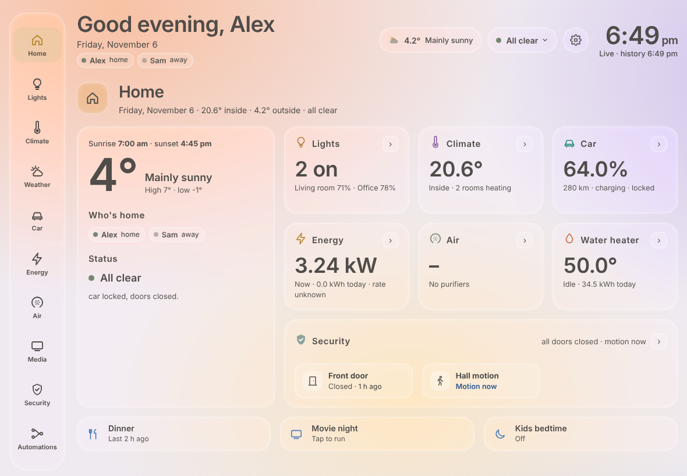
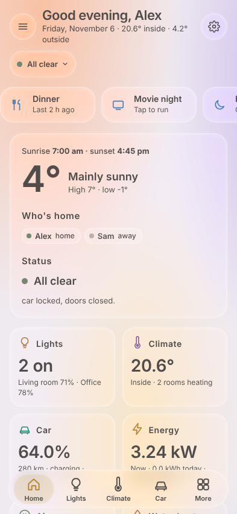
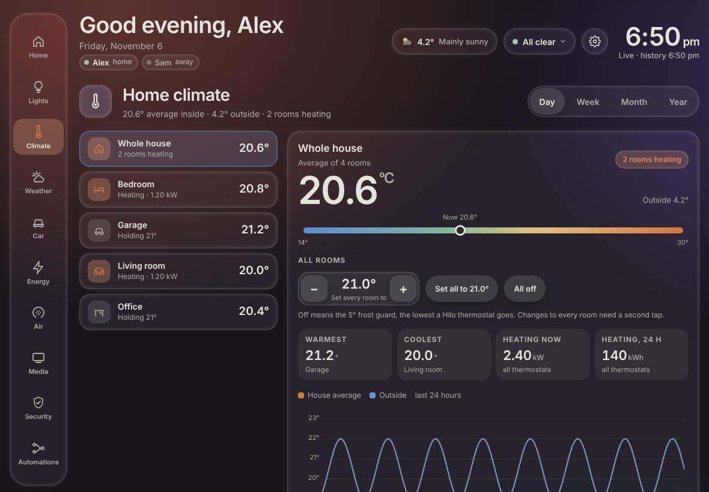

# Home panel for Home Assistant

A dashboard for a tablet on the wall and for your phone, installed as its own page in the Home Assistant sidebar.
It covers energy, climate, lights, weather, the car, air quality, media, security and a timeline of your automations.
It follows the sun between a light and a dark theme, has a frosted-glass look with animated wallpapers, and speaks French
to users whose Home Assistant profile is in French.



| Phone | Climate, dark theme |
|---|---|
|  |  |

It's mostly for monitoring. You can control lights, scenes, thermostats, media players, the EV charger and a FordPass car.

## What it uses

Every section is optional. A section shows only when its entities exist, so a house without a car never sees a Car tab.

| Section | Works with |
|---|---|
| Weather | any `weather` entity. Environment Canada's extra sensors are found automatically. The radar needs [Weather Radar Card](https://github.com/Makin-Things/weather-radar-card) from HACS |
| Climate | every `climate` entity, with temperature, setpoint and power history from sensors named like Hilo's (`sensor.<thermostat>_temperature`, `_target_temperature`, `_power`), or set per room |
| Lights | lights by area, with [Adaptive Lighting](https://github.com/basnijholt/adaptive-lighting) when installed |
| Energy | a whole-house power sensor, a water heater, an EV charger, [Hilo](https://github.com/dvd-dev/hilo) rates and Hydro-Québec peaks |
| Car | the [FordPass](https://github.com/itchannel/fordpass-ha) integration |
| Air | Mila purifiers and air sensors |
| Security | door, window and motion sensors, UniFi Protect cameras |
| Media | TVs (Wake-on-LAN), speakers |
| Automations | your automations' own traces, drawn as flow charts |

## Install

1. Download `home-panel.zip` from the [latest release](../../releases/latest), or build it yourself (below).
2. Unzip it into `<config>/www/home-panel/`, so that `home-panel.js` sits at `<config>/www/home-panel/home-panel.js`.
3. Add the panel to `configuration.yaml`:

   ```yaml
   panel_custom:
     - name: home-panel
       sidebar_title: Home panel
       sidebar_icon: mdi:home-analytics
       url_path: home-panel
       module_url: /local/home-panel/home-panel.js?v=2.1.0
   ```

4. Restart Home Assistant. The panel shows up in the sidebar.

Home Assistant caches files under `/local/` for 31 days. After each update, change the `?v=` number and restart.

## Configure

Without a `config:` block, the panel finds what it can by itself: the weather entity, thermostats, people, lights, sensors and a FordPass car.
Add a `config:` block under the panel to name the rest of your devices, pick the room order or add a picture of your house.
[examples/configuration.yaml](examples/configuration.yaml) lists every option.

```yaml
    config:
      people: [Alex, Sam]
      house_image: /local/home-panel/my-house.webp
      entities:
        grid_power: sensor.house_power
        water_heater_temperature: sensor.water_heater_temperature
        ev_charger_power: sensor.charger_power
      rooms:
        - {climate: climate.living_room, name: Living room, icon: sofa}
        - climate.bedroom
      scenes: [scene.dinner, scene.movie_night]
```

An area holding several light groups shows as one card with a button per group. To give each group its own card, list the area under `split_light_areas`, for example `split_light_areas: [living_room]`.

Room icons can be `sofa`, `door`, `desk`, `bed`, `bath`, `drop`, `car`, `house` and `therm`.

## Develop

You need Node 20 or later.

```sh
npm ci
npm run build          # dist/home-panel.js plus the vendored libraries
npm test               # unit tests: config, build, French, a scan for personal data
npm run test:e2e       # builds, then opens every tab in Chromium on a made-up house
```

The first run of `test:e2e` needs a browser: `npx playwright install chromium`.

The source is one custom element in `src/home-panel.src.js`. `build.mjs` splices in the CSS (`src/css/`), the French
translations (`src/i18n/`), the Automations tab (`src/auto.js`) and the configuration code (`src/config.js`).
The test house in `test/e2e/harness.html` is made up. Keep real names, addresses and entity IDs out of the repository:
`npm test` fails if it finds some of them.

## Credits

The colour palette comes from [Origami](https://github.com/hazymorning/origami) by hazymorning.
Charts are drawn by [ApexCharts](https://apexcharts.com), maps by [Leaflet](https://leafletjs.com) and automation flows by
[Mermaid](https://mermaid.js.org). Their licences are in [vendor/LICENSES.md](vendor/LICENSES.md).

## Licence

MIT, see [LICENSE](LICENSE).
