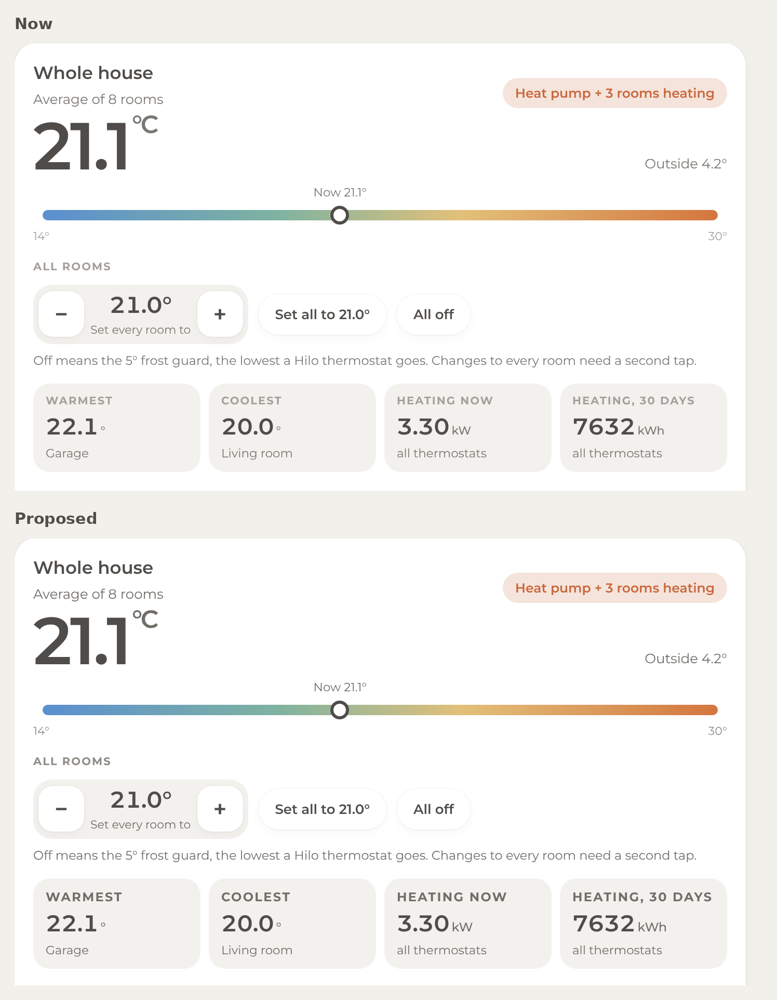
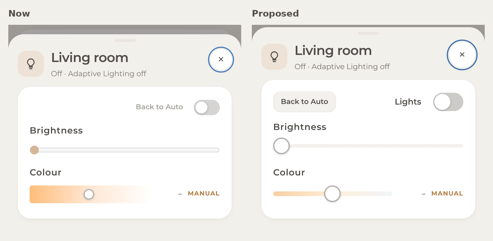
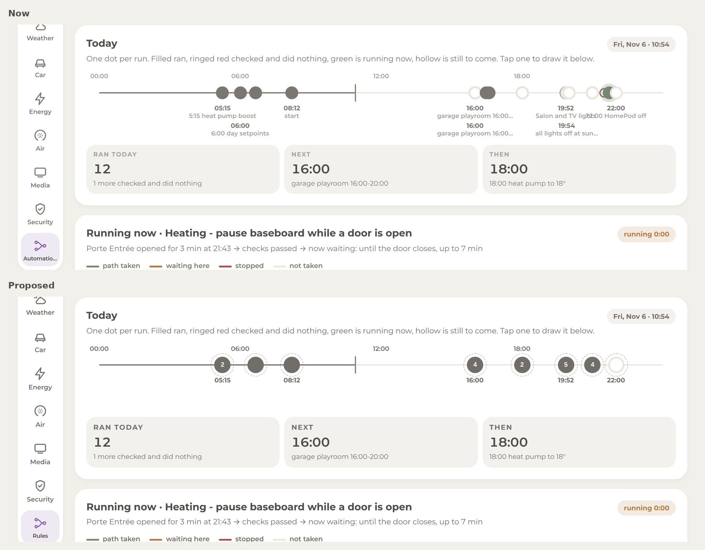
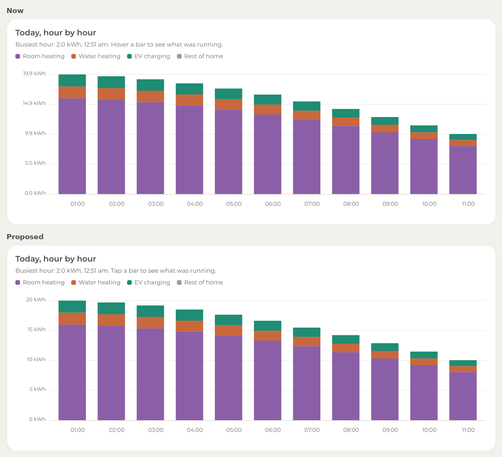
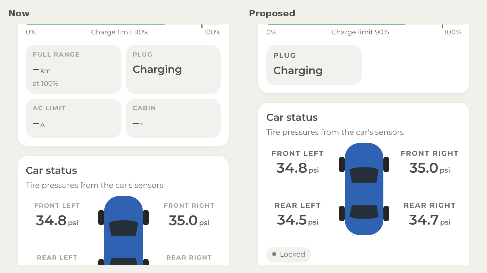

# Home panel vs Apple HIG review

> Moved from the Claude artifact [VZuGg5Z8H9fEZFtN5jhRH7](https://claude.ai/artifact/VZuGg5Z8H9fEZFtN5jhRH7), first published 2026-11-06.

Nov 6, 2026

## Summary

The panel gets the big decisions right by Apple's standards: a tab structure that changes shape with the screen (a rail on the iPad, a bottom tab bar plus More on the iPhone), standard component shapes (list rows with switches, segmented controls, steppers that show their value, bottom sheets with a title and a Close button), status shown next to the thing it describes, safe-area insets everywhere, Reduce Motion respected, keyboard focus rings on every control family, and an accessible label on every one of the 595 controls measured. Nothing in the structure needs to change.

Where it falls short of the Human Interface Guidelines (HIG) is mostly measurable, and mostly cheap to fix:

- **Text is smaller than Apple's floor.** Apple's minimum on iPhone and iPad is 11 pt. About a fifth of the text on every screen is 9.5 to 10.5 px: the rail labels, the uppercase stat labels, the "1 h ago" timestamps, the phone tab-bar labels.

- **The greys miss Apple's contrast minimum (4.5:1) on the cream cards.** The secondary grey measures 3.96:1 on the page background and 3.99:1 on inner tiles. The tertiary grey measures 2.3:1 in light mode and 2.85:1 in dark mode, and it carries real information (units, stat labels, timestamps). In light mode 34% of the text elements on the iPad fail, in dark mode 15%.

- **Some controls are under Apple's sizes.** Apple's default hit target is 44×44 pt with a hard minimum of 28×28 pt. The Automations timeline dots are 22×22, the switches 44×26, the brightness and colour sliders 16 and 8 px tall. The sheet Close, the menu and theme buttons, the volume steppers and the segmented controls sit between 29 and 42 px.

- **A few behaviours contradict the text of the HIG.** The phone sheets show a grabber but cannot be swiped away. The theme button is an app-level appearance setting tied to the sun rather than the system. The energy chart says "Hover a bar" on a touch screen. Errors appear as toasts that vanish after 3.5 seconds.

### Scorecard

| Area | Verdict | What the numbers say |
|---|---|---|
| Layout | Good | Safe areas on all four edges, 16 px rhythm, size-class breakpoint at 600 px. The phone header stack takes 215 px before content, and the date appears twice. |
| Navigation and modality | Good, one gap | Rail and tab bar follow the HIG pattern. Sheets have a grabber without swipe-to-dismiss. |
| Typography | Needs work | 212 of 1,017 text elements per iPad pass are under 11 px. No Dynamic Type. |
| Colour and dark mode | Needs work | Secondary grey 3.96:1, tertiary 2.3:1 (light) and 2.85:1 (dark). Primary text 7.5:1 and 14:1, fine. |
| Controls and touch targets | Mixed | 36 controls per iPad pass are under 28 pt (sliders, switches, timeline dots), 140 under 44 pt. |
| Charts | Good, two fixes | Familiar chart types with headline subtitles. "Hover" wording, no text alternative, odd tick values. |
| Feedback and loading | Good, one fix | Status sits next to the item, empty states explain themselves. Errors auto-dismiss. |
| Accessibility | Good foundation | 0 unlabelled controls, focus rings, Reduce Motion, aria-live. Contrast and size pull it down. |
| Apple Home comparison | Consistent | Same status-first reading, same tile vocabulary. Sensor names are duplicated in Home Assistant, not in the panel. |

The Recommendations section ranks 18 fixes. The first five (text floor, greys, hit areas, "Tap a bar", the truncated rail label) are a single small release.

## Scope and method

**What was reviewed.** Home panel v1.16.1, the version deployed to the Home Assistant share on 2026-11-06 and in the infrastructure repository. The ten tabs (Home, Lights, Climate, Weather, Car, Energy, Air, Media, Security, Automations) on the iPad, the same ten tabs plus the eleven bottom sheets on the iPhone, each in the light and the dark theme. Four configurations in all.

**How.** Two sources of evidence:

1.  **Screenshots** of every screen at iPhone 16 size (393×852) and wall-iPad landscape size (1180×820), reviewed by eye against the HIG rules.

2.  **A measurement pass** (`hig-audit.js`, Playwright with the panel's mock Home Assistant data) that walked every visible control and text element and recorded its hit-area size, computed font size and weight, text colour, the composited background behind it, and the resulting contrast ratio. Apple's thresholds were applied directly: 44 pt default and 28 pt minimum for controls, 11 pt minimum text, 4.5:1 contrast for text under 18 pt and 3:1 for larger or bold text.

| Configuration | Controls measured | Under 44 pt | Under 28 pt | Text elements | Contrast fails | Under 11 px |
|---|---|---|---|---|---|---|
| iPad, light, 10 tabs | 285 | 140 | 36 | 1,017 | 341 (34%) | 212 (21%) |
| iPad, dark, 10 tabs | 285 | 140 | 36 | 1,017 | 152 (15%) | 212 (21%) |
| iPhone, light, 10 tabs | 177 | 77 | 25 | 465 | 184 (40%) | 87 (19%) |
| iPhone, light, 11 sheets | 133 | 80 | 5 | 646 | 240 (37%) | 88 (14%) |

CSS pixels equal points on iOS, so the numbers compare directly with Apple's.

**Which HIG pages.** Layout, Designing for iOS, Designing for iPadOS, Tab bars, Sidebars, Toolbars (which now holds the navigation-bar guidance), Sheets, Modality, Popovers, Alerts, Typography, Color, Dark Mode, Materials, Buttons, Toggles, Sliders, Segmented controls, Steppers, Lists and tables, Charting data, Charts, Accessibility, Feedback, Loading, HomeKit, Widgets, Icons, SF Symbols. Apple's pages were read in their Markdown form (the HTML needs JavaScript); the tab-bar and sidebar pages carry a June 2026 revision date.

**Caveats.**

- The HIG is written for native apps. A web panel inside the Home Assistant app cannot use SF Symbols rendering modes, Liquid Glass, haptics, or Dynamic Type for free. Where a rule cannot apply, the section says so instead of counting it against the panel.

- The measurement harness renders with the system sans-serif, not Montserrat, and with mock data (no cameras connected, synthetic sun times such as "Sunrise 1:34 am" on the Home card). Sizes and colours are unaffected; the real device may wrap or truncate text slightly differently.

- "Under 44 pt" counts everything below Apple's default, including 36 to 42 px buttons that are usable. "Under 28 pt" is the hard failure.

- The iPad was reviewed in landscape only, which is how the wall panel is mounted. Portrait was not checked.

## Layout

**Apple's rules.** Put the most important content near the top and the leading edge. Group related items with negative space or containers. Use progressive disclosure. Respect the safe areas. Decide the layout from the size class, not the device. Keep the same functionality across sizes. Keep truncation to a minimum. The Widgets page adds: 16 pt standard margin, 11 pt where content is grouped tightly, and "balance information density" (essentials at a glance, details on a longer look).

**What the panel does well.**

- Safe areas are honoured on all four edges: the page wrap, the fixed bottom bar on the iPhone, the sheets and the toast all use `env(safe-area-inset-*)`. The home indicator never covers the tab bar.

- The compact layout keys on width (under 600 px), which is a size-class decision, not a device check. The iPad in Split View would get the phone layout, which is the HIG's intent.

- Both layouts expose every section. The phone hides nothing behind the iPad-only rail; it moves six sections into More.

- The grid rhythm is 16 px between cards and 16 px page margin, matching Apple's widget margin exactly. Tiles inside cards use a tighter 10 to 12 px, close to Apple's 11 pt grouping margin.

- The Home tab reads top-down in the order the HIG asks for: weather and who's home, then six glance tiles (one big number, one line of detail each), then Security, then scenes. Each tile is one idea, which is the widget page's "simple ideas" rule.

- Cards sit on a single column on the phone and a two-column grid on the iPad with the right column bottom-aligned to the weather card. Nothing is stretched to fill, which the Widgets page warns against.

**Findings.**

1.  **The phone header spends 215 px before the first card.** Menu button, greeting (two lines), date, attention chip, then the pane icon, pane title and a two-line subtitle. The date appears twice: under the greeting and again at the start of the Home subtitle ("Friday, November 6 · 21.1° inside…"). On the iPad the same duplication exists but costs nothing. Apple's iPhone guidance is to limit what is on screen and lead with a large title. Fix: on the phone, one title block only. Keep "Good morning, the owner" as the large title on Home and the section name on the other tabs, drop the date line under the greeting, and let the attention chip sit in the same row as the theme button. That returns about 60 to 70 px to content on every tab.

2.  **"Automations" is truncated to "Automatio…" in the iPad rail** and shrunk to 9.5 px to try to fit. The tab-bar page says to use single-word labels, and the typography page says to keep truncation to a minimum. Fix: rename the tab ("Rules" or "Flows"), or widen the rail from 72 to 84 px, or drop the letter-spacing on rail labels. Renaming is the smallest change.

3.  **Tile titles truncate on both devices**: "Mustang Ma…" on the iPad Home tab, "Water h…" on the phone. Fix: shorter tile titles ("Car", "Water") and keep the model name in the Car pane header.

4.  **Scenes are the last thing on the phone's Home tab**, about 1,450 px down, below the five Security rows. Apple Home puts scenes first because they are the most-tapped items. The bottom position was chosen for the iPad, where everything is visible at once; on the phone it means scrolling past everything to reach "Movie night". A horizontally scrolling scene row directly under the six tiles would keep the iPad as it is. This is a preference call.

5.  **The Security card on the Home tab shows five rows**, two of which are near-duplicates ("Porte Entree" and "Porte Entrée Door", "Premier Etage" and "Premier Étage Occupancy"). That is a naming issue in Home Assistant rather than a layout one; see the Apple Home section. Until the entities are renamed, the card could show one row per device.

6.  **The weather pane's Environment Canada line** ("No warnings, watches or advisories…") takes a full-width card to say nothing is happening. The HIG's progressive-disclosure rule suggests showing it only when there is a warning, with a one-line "No alerts" in the pane subtitle otherwise (the subtitle already says "no alerts").

7.  **The Automations timeline labels overlap** when runs are close together (16:00, 19:36, 19:52, 21:43, 22:00 on the sample day) and get clipped at the right edge. The labels need either staggering on two rows or hiding until a dot is tapped.

8.  **Portrait iPad is untested.** At 820 px wide the tablet layout applies; the two-column grids will be tight but above the breakpoint. Worth one look if the iPad is ever rotated.

## Navigation and modality

**Apple's rules.** A tab bar is for top-level sections, stays visible while moving between them, has short labels (single words), uses filled symbols, and should avoid the overflow More tab. A sidebar needs a lot of space, shows at most two levels, and iPadOS prefers a tab bar that can convert to a sidebar. Sheets are for a scoped task related to the current context; include a grabber only if the sheet is resizable; support swiping to dismiss; put Cancel on the leading edge and Done on the trailing edge; show one sheet at a time; give it a title that names the task. Popovers are for wide layouts; use a sheet in compact ones. A modal view needs an obvious way out and should stay short.

**What the panel does well.**

- **iPad rail.** A vertical tab bar on the leading edge with icon over label, one level deep, every section always one tap away. The selected tab gets a tinted pill in the section's colour. The HIG says sidebar icons should use the accent colour and "use fixed colors sparingly"; the per-section colours are a deliberate choice that matches the pane header, so they read as one system rather than noise.

- **iPhone tab bar.** Four sections plus More, fixed at the bottom over a blurred translucent background, which is exactly the iOS tab-bar material. Labels are single words. Hidden only under a sheet, which the HIG allows.

- **More** opens a grid of the six remaining sections with their live status ("Energy · 3.24 kW now"), which is richer than the system More list and lets the sheet double as a status page. The HIG still says to avoid overflow tabs where possible; six hidden sections is a lot. An alternative is five tabs (adding Energy) and five in More. Not urgent.

- **Sheets on the phone** rise from the bottom, full width, with a title, a subtitle that names the room or task, a Close button, a dimmed and blurred backdrop, and Escape and backdrop-tap to dismiss. Focus moves to Close when a sheet opens and returns afterwards, which is what VoiceOver and keyboard users need.

- **On the iPad the detail sheets are panes.** Opening Weather, Energy, Climate, Air or Car switches tab instead of presenting a modal. The iPadOS page asks for exactly this: "minimize modal interfaces and full-screen transitions." Only the camera viewer stays modal, which fits the HomeKit rule that nothing should cover a camera image.

- **One sheet at a time.** `show()` replaces whatever is open; there is no stacking.

**Findings.**

1.  **The grabber promises a gesture the sheet does not have.** The phone sheets draw a grabber bar at the top, but there is no drag-to-dismiss and no medium detent. The Sheets page says to include a grabber in a resizable sheet and to support swiping to dismiss. Either add a simple drag-down-to-close on the header (pointer events, dismiss past 80 px or a fast flick) or remove the grabber. Adding the gesture is the better fix: it is the first thing an iPhone user tries.

2.  **Close sits top-right at 36 px.** The Toolbars page puts Cancel on the leading edge. Apple Home's own accessory sheet, though, uses a circled × at the top right, and that is the app the panel is compared against, so the position is fine. The size is not: make it 44 px.

3.  **Selected tab icons are outlines.** The tab-bar page prefers filled symbols for tabs. The rail and bottom bar use outline icons with a tinted pill. Minor, and the pill does the job; a filled variant for the selected state would match iOS more closely.

4.  **The sidebar menu button** (top-left, 38 px) opens Home Assistant's own sidebar. It is the only route to the rest of Home Assistant and is unlabelled visually (icon only, with an aria-label). Fine, but it competes with the greeting on the phone; it could move into the More sheet as a "Home Assistant" row on the phone.

5.  **Sheet height.** Sheets open at full height with their own scroll. The HIG suggests a medium detent on iPhone for progressive disclosure. The light sheet (one toggle and two sliders) would suit a half-height sheet; the climate and car sheets need full height. Optional.

## Typography

**Apple's rules.** The default text size on iOS and iPadOS is 17 pt and the minimum is 11 pt. Avoid Ultralight, Thin and Light at small sizes. A custom font must stay legible at the minimum sizes and should implement Dynamic Type and Bold Text like the system font. Let people enlarge text to at least 200%. Keep truncation to a minimum. Minimise the number of typefaces. Avoid tight leading on three or more lines.

**Measured size distribution on the iPad (1,017 text elements across the ten tabs).**

| Size | Count | Share | Where |
|---|---|---|---|
| 9.5 to 10.5 px | 212 | 21% | Rail labels (10.5, and 9.5 for "Automations"), uppercase stat labels ("WARMEST", "PM2.5", "ODOMETER"), "· 1 h ago" timestamps, Adaptive Lighting hour marks |
| 11 to 12 px | 232 | 23% | Units (kWh, µg/m³, ppm), tile detail lines, "never" and run times in the Automations list, list-row status |
| 12.5 to 14 px | 289 | 28% | Body: subtitles, chip text, helper sentences, segmented labels |
| 15 to 17 px | 95 | 9% | Card titles, list-row names |
| 18 px and up | 189 | 19% | Pane titles, big numbers (22 to 78 px), clock |

The phone is the same picture with the tab-bar labels at 10 px.

**What the panel does well.**

- One typeface (Montserrat) in weights 400 to 700; no thin weights anywhere.

- Numbers use tabular figures with tightened letter-spacing, so live values do not jitter as digits change. This is the same treatment Apple gives numeric text.

- Clear hierarchy: a 28 px pane title, 17 to 18 px card titles, 13 to 14 px body, 22 to 78 px hero numbers. Leading is 1.4 for body and 1.0 to 1.05 for single-line numbers, which matches Apple's 17/22 body ratio.

- Headline-style subtitles ("Busiest hour: 2.0 kWh, 12:36 am") carry the message, so the big number is not the only thing a glance gets.

**Findings.**

1.  **A fifth of the text is below Apple's 11 pt floor.** The worst offenders are also the ones that carry meaning: the uppercase stat labels at 10.5 px bold with 0.1 em letter-spacing (they look smaller than they are because of the spacing), the rail labels, the timestamps. Fix: nothing below 11 px, 12 px for the uppercase labels (uppercase plus letter-spacing needs a point more to read at the same ease), 11 px for the tab-bar and rail labels. Apple's own tab-bar labels are 10 pt, so 11 is already a point generous.

2.  **Body text is 13 to 14 px against Apple's 17 pt default.** This is defensible for a dashboard: the Designing for iPadOS page says to set density by viewing distance, Apple Home itself uses 13 to 15 pt for tile subtitles, and a wall panel at a metre needs big numbers more than big prose. The hero numbers (56 to 78 px) carry the glance. Keep 13 as the floor for sentences, but nothing informational below 12.

3.  **No Dynamic Type.** Every size is a fixed px value, so the iPhone's text-size setting does nothing inside the panel. The Accessibility page asks for 200% enlargement. WebKit exposes the user's text size through `font: -apple-system-body`; setting the panel's root size from it (then using rem everywhere) would make the whole panel scale with the system setting. That is a medium-sized change because the layout would need to stack at larger sizes. A smaller step is a text-size option (Normal / Large) in the Status menu that bumps the root size by 15%.

4.  **Truncation** in four places: "Automatio…" (rail), "Mustang Ma…" and "Water h…" (tile titles), and overlapping timeline labels in Automations. Shorter titles fix three of them; the timeline needs staggered labels.

5.  **Uppercase labels at 10.5 px with 0.1 em tracking in the tertiary grey** combine three legibility penalties on the same element: small, spaced, low contrast. Any one of them is fine; together they make "HEATING, 30 DAYS" and "FRONT LEFT" the hardest text on the panel to read. Raising the size and using the secondary grey fixes it without changing the style.

## Colour, materials and dark mode

**Apple's rules.** Text and background need at least 4.5:1 contrast (3:1 for text of 18 pt or more, or bold); for custom colours Apple says to aim for 7:1, "especially in small text". Never rely on colour alone. Use each colour for one meaning. Supply light, dark and increased-contrast variants. Avoid an app-specific appearance setting; follow the system. Dark colours are not inversions of light ones; prefer dim base and brighter elevated surfaces. Glass and blur belong to the navigation layer, not the content layer.

**Measured contrast of the palette as used.**

| Role | Light theme | Ratio on page / tile / card | Dark theme | Ratio on card / tile |
|---|---|---|---|---|
| Primary text `--fg` | \#4F4C49 | 7.5 / 7.5 / 8.6 | \#E5E3DD | 14.0 / 11.9 |
| Secondary `--fg2` | \#7A7672 | **3.96 / 3.99** / 4.50 | \#A9A6A0 | 5.65 / 5.02 |
| Tertiary `--fg3` | \#A4A09B | **2.28 / 2.30 / 2.60** | \#7D7A75 | **3.21 / 2.85** |
| Stat label `--label` | \#8A7A64 | **3.69** / 4.16 | \#A9A6A0 | 5.0 |
| EV green as text `--c-ev` | \#1F8C74 | **4.15** on white | \#36A487 | **4.46** |
| Blue as text `--c-home` | \#4A7DBA | **3.77** on tile | \#6593D6 | **3.89** |
| Warn as text `--warn` | \#B27C43 | **3.18** (used bold, so 3:1 applies) | \#EABA89 | 7.7 |

Bold figures fail Apple's 4.5:1 for small text. "Page" is \#F2F0EB, "tile" the inner \#F3F1ED, "card" white.

**What the panel does well.**

- Primary text is comfortably above 7:1 in both themes.

- Status is never colour alone: "Open" is orange **and** says Open, "Motion now" is blue and says so, air quality shows a dot plus the word ("Moderate"), the Automations dots differ by shape (filled, ring, half, hollow) as well as colour, switches change position as well as colour.

- The dark palette is a retuned set, not an inversion: cards \#2F2D2A on a \#181715 base with the lighter inner tiles \#383532, which is Apple's "elevated surface is brighter" model. Accents are brightened for dark backgrounds rather than reused.

- Materials are in the right layer: the iPhone tab bar is translucent and blurred (`backdrop-filter`), the sheet backdrop dims and blurs the page, and content cards are opaque. That is the HIG's "glass in the navigation layer, not the content layer" split.

- One accent per section (lights amber, climate orange-red, car teal, energy gold, air sage, media blue, security sage, automations purple) and the same colour is used for the rail pill, the pane icon and the tile icon of that section, so colour means "which section" consistently.

**Findings.**

1.  **The secondary grey fails on cream.** \#7A7672 passes only on white cards (4.50:1) and fails on the page background and on the inner tiles (3.96 and 3.99). It is the colour of every unit (kWh, µg/m³, ppm, %, °), every tile detail line, the date, "Live · history", the unselected segments (Month, Year). Fix: `--fg2: #716D69` meets 4.5:1 on all three surfaces with no visible change in character; `#66625E` reaches 5.2:1 and is closer to Apple's 7:1 aim.

2.  **The tertiary grey fails everywhere, and it carries information.** \#A4A09B (2.3:1) is used for the uppercase stat labels, "· 1 h ago", "never" in the Automations list, "away" in the who's-home chips. Apple's own tertiary label colour is also below 4.5:1, so the rule is not "make it darker" but "use it only for decoration". Fix: stat labels, timestamps and "never" move to the secondary grey; keep `--fg3` for separators, dots and the "—" placeholders. If a third tone is wanted for words, `#8F8B86` reaches 3:1, which Apple allows for bold or 18 pt text only.

3.  **Dark tertiary** \#7D7A75 is 2.85:1 on tiles and 3.21:1 on cards. Same uses, same fix. `#A09D98` gives 4.5:1 on both.

4.  **Accents used as text at small sizes.** "Automagic" (selected segment, 15 px semibold) in EV green is 4.15:1 on white; the "Auto" pill text in blue is 3.77:1 at 12 px. Dark: 4.46 and 3.89. Fixes that keep the hue: light `#0F7C64` and `#3D70AD`, dark `#41AF92` and `#719FE2`. Alternatively make the selected segment text the primary colour and keep the green for the segment's border or dot.

5.  **The theme control is an app-level appearance setting.** The ◐ button cycles Auto, Light, Dark, and Auto follows the sun entity rather than the device. The Dark Mode page says an in-app appearance setting "creates more work for people" and to follow the system, whose own Auto already switches at sunset. On the wall iPad the two agree in practice; on the iPhone a user with Dark Mode on gets the light panel in the daytime. Fix: Auto means `prefers-color-scheme`; keep the manual override as a row in the Status menu for the wall panel. Small change.

6.  **No Increase Contrast variant.** The HIG asks for an increased-contrast option for each custom colour. A `@media (prefers-contrast: more)` block that swaps the greys for the darker set from finding 1 would cover it in a dozen lines.

7.  **Green does double duty.** EV teal is the Car section colour, the switch-on colour, the "Good" air dot and the Automations "running" state. Switch-on green is an iOS convention and "Good" green is universal, so this is acceptable; just avoid adding a fifth meaning.

## Controls and touch targets

**Apple's rules.** A control's hit region is at least 44×44 pt by default and never under 28×28 pt, with about 12 pt of padding around bezelled controls. Custom buttons need a press state. Use a switch only in a list row; elsewhere use a button that toggles. Do not rely on colour alone for a toggle's state. A slider fills the track up to the thumb; pair it with a text field or stepper for exact values and give live feedback while dragging. A stepper shows no value, so put the value beside it. Segmented controls take two to about five segments on iPhone, noun labels, equal widths. Lists give selection feedback and use a disclosure indicator to drill in.

**Measured hit areas (iPad; the phone matches except where noted).**

| Control | Size | Apple | Where |
|---|---|---|---|
| Automations timeline dots | 22×22 (16×16 when skipped) | under the 28 minimum | Automations, 20 per screen |
| Switches `.sw` | 44×26 | under 28 tall; iOS switch is 51×31 | Lights, Car, Media |
| Brightness slider | 303×16 | under 28 tall | Lights (4) |
| Colour-temperature slider | 183 to 247 × 8 | under 28 tall | Lights (4) |
| Sheet Close × | 36×36 | between 28 and 44 | every phone sheet |
| Sidebar menu, theme button | 38×38 (iPad theme 42) | between | every tab |
| Volume − / + | 38×38 | between | Media |
| Play / pause | 40×40 | between | Media (phone) |
| Segmented controls, period tabs | 36 to 38 tall | between | Climate, Energy, Air, Car |
| "Auto" / "Back to Auto" pill | 50×29 | between | Lights |
| "All off" | 67×34 | between | Lights |
| Security card header (whole row is a button) | 658×28 | at the minimum | Home |
| Tiles, list rows, rail tabs, scene tiles, TV buttons | 56 to 120 tall | fine | everywhere |

**What the panel does well.**

- Every control has an accessible name: 0 unlabelled out of 595 measured (icon buttons carry aria-labels such as "Volume down" and "Theme: light. Tap to change").

- Press states exist: tiles and scene tiles scale to 98% on `:active`, buttons change fill, rail and tab-bar items set `aria-selected`, toggles set `aria-pressed`.

- Switches appear only in list rows (light rooms, Samsung TV, Charging, Lock charger, Departure times), which is precisely the HIG's switch rule. Elsewhere, state changes use pills and segmented controls.

- The setpoint stepper shows its value and what it changes ("21.0° Set every room to"), with a sentence explaining Off and the second-tap confirmation. The Steppers page asks for exactly that.

- Segmented controls are small and nouns: Day / Week / Month / Year, Now / Today / 30 days, Automagic / Manual, 50% to Full. Equal widths, two to six segments.

- Volume is a stepper with a percentage, which is what Apple recommends on iOS instead of a volume slider.

- Sliders fill the track to the thumb (brightness) or show the gradient they select from (colour temperature), with the value beside them on the iPad ("2200 K").

- Quick setpoints (Off, 19°, 20°, 21°, 22°) give one-tap access to the common values, which the Sliders page suggests for accuracy.

**Findings.**

1.  **Timeline dots are the one hard failure.** 22 px (16 when a run was skipped) and 20 of them in a row. Fix: keep the 22 px dot but give the button a 44 px hit area (padding or a transparent `::before`), and space dots so areas do not overlap; when runs are closer than 44 px, merge them into one dot with a count.

2.  **Switches are 26 px tall.** The iOS switch is 51×31. Fix: draw the switch at 51×31 (it also reads better at a metre), or keep the look and pad the button to 44 px tall. On the phone the whole list row is also tappable, which softens this.

3.  **Sliders are 8 and 16 px tall.** The track can stay thin; the input needs a 44 px tall hit area and a 28 px thumb, which is what the iOS slider has. The colour slider on the phone also shows no value while dragging (the iPad shows the Kelvin value). The Sliders page asks for live feedback.

4.  **"Back to Auto" is a switch with a verb label.** A switch names a state; an action is a button. On the Living room card and sheet the switch is off and labelled "Back to Auto", which reads as a command. Fix: label it "Adaptive Lighting" (on / off), or make "Back to Auto" a button that appears only when the light is manual, which is the pattern on the iPad card for rooms already in Auto.

5.  **Mid-size buttons.** Close (36), menu (38), theme (38/42), volume (38), play/pause (40), segments (36 to 38), Auto pill (29), All off (34). All above Apple's minimum, all below the default. Fix: 44 px for the round icon buttons and 40 to 44 for segments; the Auto pill can stay small if its row stays tappable.

6.  **The Security card header is a 28 px tall button** spanning the card. It opens the Security tab; the "›" chevron is the only hint. It works, but a 44 px header row with the chevron at the trailing edge would match the disclosure-indicator pattern on the tiles.

7.  **Quick setpoints mix "Off" with temperatures.** The Segmented Controls page says not to mix actions with selections in one control, but these are pills, not a segmented control, and Off is a valid setpoint (the 5° frost guard). No change needed.

## Charts and data

**Apple's rules.** Use a chart only to highlight something about the data, keep it simple, and let detail come gradually. Prefer familiar types (bar, line); if you use a novel chart, help people read it. Give every chart a title that states its message and a legend for anything encoded by colour or shape. Use a fixed axis when the bounds are meaningful (0 to 100%) and a dynamic one when values vary; prefer familiar tick sequences (0, 5, 10). Make every chart accessible: a text summary, no reliance on colour alone, a hit area that covers the whole plot, and a non-animated alternative for animated changes.

**What the panel does well.**

- The chart types are the familiar ones: stacked bars for energy by hour, lines for the 7-day room temperature with a dashed setpoint, small daily bars for 30 days of EV charging, a sun arc, a horizontal gradient bar for the thermostat range.

- Every chart has a title and a headline subtitle that says what matters ("Busiest hour: 2.0 kWh, 12:36 am", "9 h 53 min of daylight, 2 min 46 s shorter than yesterday", "Daily EV energy, last 30 days: 29 charging days, 954 kWh"). This is the Charting Data page's advice almost word for word.

- The one novel chart, the Sankey "Where the power goes", comes with a plain sentence explaining how to read it ("the Hilo meter on the left, each device's own sensor on the right") and a Now / Today / 30 days switch.

- Axis choices are right: battery and charge limit on a fixed 0 to 100% bar; room temperature on a dynamic 19 to 22° range (a zero baseline would flatten the thing being shown, which the Charts page calls out with its heart-rate example); the thermostat bar fixed at 14 to 30° with the setpoint marked.

- Legends exist wherever colour encodes a series (Room heating, Water heating, EV charging, Rest of home; House average, Outside).

- Chart animations are turned off when Reduce Motion is on.

- The Automations timeline explains its dot vocabulary in one sentence and uses shape (filled, ring, half, hollow) as well as colour.

**Findings.**

1.  **"Hover a bar to see what was running."** There is no hover on a touch screen; the Accessibility page says to offer on-screen alternatives to gestures, and "hover" is not even a gesture here. Fix: "Tap a bar". One-word change in two languages.

2.  **Charts have no text alternative.** The ApexCharts SVGs expose nothing to VoiceOver. The Charts page asks for a summary (chart type, axes, bounds, main message) and labels on the important marks. Fix: give each chart container an `aria-label` built from the data the subtitle already uses ("Stacked bar chart, today by hour, 0 to 20 kWh, busiest hour 12:36 am at 2.0 kWh, room heating is most of it") and `role="img"`. Small, because the sentences already exist.

3.  **Axis ticks are 0.0, 5.0, 9.9, 14.9, 19.9 kWh.** The Charts page prefers familiar sequences. ApexCharts' `forceNiceScale` with a tick count of 4 or 5 gives 0, 5, 10, 15, 20.

4.  **Legends and stacks rely on colour alone.** Purple, orange, teal and grey are distinguishable for most people, but the Charts page asks for a second cue. Cheap mitigation: on tap, show the breakdown as text (the "what was running" tooltip already does this), and add the series name to the tooltip. A pattern fill on one series is the fuller fix and can wait.

5.  **The hit area for bars** is the bar itself. The Charts page suggests the whole plot area so people can scrub. ApexCharts supports `intersect: false` with a shared tooltip, which makes a tap anywhere in a column select that hour.

6.  **Flow graphs on the phone are clipped.** The Mermaid diagrams in Automations run left to right and overflow the 393 px screen; the visible part shows two or three nodes. A top-to-bottom layout under 600 px (Mermaid `TD`) would show the whole chain, and the 10 to 11 px node text should follow the 11 px floor.

7.  **The Adaptive Lighting day strip** has 10 px hour marks ("12 am", "6 am") and no value except "Now 3380 K" in the card header. Fine as a glance, but the hour marks need 11 px.

8.  **Sparkline-style EV bars** (phone Car tab) have no axis and no values on tap. They are explicitly a glance element with the total in the caption, which is the Charting Data page's "show the summary" advice. No change.

## Feedback, status and loading

**Apple's rules.** Match the delivery to the significance: status can be passive, a possible loss must interrupt. Use several channels (colour, text, sound, haptics). Show status near the item it describes. Use alerts sparingly, never for information alone. Confirm only when something fails; people "only need to know when it doesn't" succeed. When a command cannot be carried out, say so and why. Minimise elements that dismiss themselves on a timer. Show something as soon as possible while loading, with placeholders; use an indicator when loading takes more than a moment.

**What the panel does well.**

- Status sits next to the thing: each tile shows its state, Security rows say "Open · for 1 h", the lights rows say "On · 71% · Auto", the speaker rows say what is playing.

- Problems are a passive chip ("1 thing needs attention") in the header plus a Status list on the Home card, not an alert. That is the right weight for an open door.

- Empty states explain themselves and say what to do: "No cameras yet. Add UniFi Protect in Settings → Devices & services…", "The TV doesn't report its volume, so there's no slider", "No outdoor history yet".

- Commands show a pending state: car controls grey out while a service call runs, the TV shows "Turning the TV on", the setpoint stepper asks for a second tap before changing every room.

- The header says how fresh the data is ("Live · history 10:36 am"), which the Widgets page asks for when people check more often than data updates.

- The toast is `role="status"` with `aria-live="polite"`, so VoiceOver announces it; the climate detail region is also polite-live.

**Findings.**

1.  **Errors vanish after 3.5 seconds.** A failed service call shows "Didn't work: …" in the same toast as a theme change, then disappears. The Feedback page says to show when a command cannot be carried out and explain why; the Accessibility page says to minimise auto-dismissing elements. Fix: errors stay until tapped (or until the next successful command), and the failing control reverts and shows a small mark. Successes can stay short.

2.  **Success toasts are redundant.** "Theme: dark" announces a change the eye already saw; "Turning the TV on" is useful because the TV takes seconds. Keep toasts for things that take time or that are not visible; drop the ones that only echo the screen.

3.  **Permanent dashes read as broken.** The Car pane shows four tiles with "—" (Full range, AC limit, Cabin, 12 V battery, Software, Auto updates) because the Ford integration never reports them. A dash is right for a value that is momentarily missing; six permanent dashes look like a fault. Fix: hide tiles whose sensor has never reported, or say "not reported" once.

4.  **Charts load into a blank card.** On first open, a chart card stays empty until the chart library arrives. The Loading page asks for a placeholder. A one-line "Loading history…" in the secondary grey, or a faint axis skeleton, is enough.

5.  **No feedback on the colour-temperature slider on the phone** while dragging (see Controls). The HIG's "live feedback as the value changes" applies.

6.  **Haptics and sound** are not available to web content inside the Home Assistant app, so the "several channels" rule reduces to colour plus text, which the panel does.

7.  **Alerts.** The panel never raises a modal alert, which is right: nothing it does is destructive or loses data. The one confirmation (second tap to change every room's setpoint) is proportionate.

## Accessibility

**Apple's rules.** Let people enlarge text to at least 200%. Meet 4.5:1 for text under 18 pt and 3:1 above, with a higher-contrast scheme when Increase Contrast is on. Convey information with more than colour. Controls 44 pt by default, 28 pt minimum, about 12 pt around bezelled ones. Offer on-screen alternatives to gestures. Reduce Motion: fewer automatic and repeating animations, fades instead of slides. Describe the interface for VoiceOver. Support keyboard and Switch Control.

**What the panel does well.**

- **Names.** 0 unlabelled controls in 595. The rail is a `nav` with `aria-label="Sections"`, tabs carry `aria-selected`, More carries `aria-haspopup="dialog"`, icon buttons carry sentence labels ("Theme: follows the sun. Tap to change"), tiles that are `div`s carry `role="button"`, `tabindex="0"` and an aria-label ("the child's room: speaker controls").

- **Keyboard.** Every control family has a visible `:focus-visible` ring (2 px in the section blue, offset 2 px). Tiles answer Enter and Space. Escape closes a sheet. Opening a sheet moves focus to Close and closing restores it.

- **Reduce Motion** is respected in four places (dash animation, tap scale, sheet slide-up, Automations pulse) and the charts disable their animations when it is on.

- **Live regions.** The toast and the climate detail are polite live regions.

- **Decorative images** have empty alt text (the house photo, speaker artwork next to its title), which is correct.

- **Native inputs for sliders.** The brightness, colour and volume sliders are `input type=range`, so VoiceOver reads and adjusts them without custom code.

- **Not colour alone.** Covered in the Colour section: every status pairs colour with a word or a shape.

**Findings.**

1.  **Text size cannot be enlarged.** Fixed px sizes ignore the device text-size setting (see Typography). This is the largest accessibility gap and the only one that needs real work.

2.  **Contrast** fails for the secondary and tertiary greys and the accents-as-text (see Colour). The fixes are palette values.

3.  **Hit areas** under 28 pt on the timeline dots, switches and sliders (see Controls).

4.  **Charts are silent** to VoiceOver (see Charts). The summary sentences already exist as subtitles; they need to become the charts' labels.

5.  **Increase Contrast** has no variant. A `prefers-contrast: more` block that uses the darker greys and solid borders on tiles would cover it.

6.  **Gestures without alternatives.** Brightness has only a slider; volume has a stepper as well. A pair of 25% steps or a tap on the track would give brightness a non-drag path. Minor.

7.  **Slider value text.** The colour slider's value is a Kelvin number; `aria-valuetext` could say "warm" to "cool" with the number, which helps more than "2200".

8.  **Language.** French users get the French engine, but the panel's root does not set `lang="fr"` on its own content when Home Assistant's page language is English, which would make VoiceOver read French text with English pronunciation. Setting `lang` on the panel root to the language actually shown fixes it in one line.

9.  **Switch Control and Full Keyboard Access** should work because everything is a real button or input; not tested on a device.

## Comparison with Apple Home

Apple's HomeKit page sets the vocabulary (rooms are names, zones group rooms, a scene is a group of actions, use "scene" not "action set", show an accessory's room and home in its detail view, never cover a camera image, defer to names set in the Home app, avoid room words in accessory names because they break voice control). The Home app itself is the practical reference for how Apple lays out a home dashboard.

| Aspect | Apple Home | Home panel | Verdict |
|---|---|---|---|
| First thing on screen | Home title, then status pills ("1 door open", "4 lights on") | Greeting, attention chip ("1 thing needs attention"), then the Home subtitle with inside / outside temperatures and the item count | Same status-first reading. The panel adds weather and who's home, which Apple Home leaves to other apps. |
| Tiles | Icon, name, state; tap toggles, long-press opens detail | Icon, name, big value, detail line; tap opens detail; switches live in list rows | The panel is monitoring-first by design. Clearer at a metre than Apple's tiles; one more tap to act. Consistent with the brief. |
| Scenes | Top of the Home tab, horizontal row | Bottom of the Home tab | Apple puts the most-tapped items first. The iPad placement was chosen deliberately; the phone would benefit from the row moving up. |
| Rooms | Rooms are the main grouping; each room shows its accessories | Sections by domain (Lights, Climate, Air) with room rows inside | Domain-first suits a wall dashboard; Apple's room-first suits a phone walking through the house. The removed Rooms view was the room-first variant. |
| Accessory detail | Sheet with a big vertical slider (brightness) and colour tiles below, close × top right | Sheet with the room name, a toggle and two horizontal sliders, close × top right | Same shape. Apple's vertical slider is easier to drag one-handed; horizontal is fine for the iPad. |
| Cameras | Thumbnails never covered, live view on tap | Security card shows up to four thumbnails, modal viewer on tap | Matches the HomeKit rule. |
| Naming | Avoid room words in accessory names; one name per accessory | "Porte Entree" and "Porte Entrée Door" are two rows; "Premier Etage" and "Premier Étage Occupancy" too | These are two Home Assistant entities per device with near-identical names. Renaming them in Home Assistant (for example "Front door", "Front door battery" or merging) fixes the panel and Siri at once. The owner's call. |
| Climate | Round dial per thermostat, no house average | Whole-house average with a gradient bar, per-room list, stepper and quick setpoints, history | Richer than Apple Home, and the HIG's steppers-and-value pattern is followed. |
| Energy | Not in Apple Home | Stacked bars, Sankey, Hilo rate | No Apple reference; follows the Charts page. |
| Automations | List with on/off, no history | Timeline of today's runs plus flow graphs lit from traces | No Apple reference; the timeline dot targets need to grow. |
| Appearance | Follows the system; white tiles over a blurred wallpaper | Cream cards, optional dark theme following the sun | Deliberate brand (Origami look). The theme should follow the system by default. |
| Icons | SF Symbols, filled when selected | Custom outline SVG set at 24 px, consistent stroke | The Icons page asks for consistent size, weight and perspective, which the set has. Selected tabs could use a filled variant. |

**Net.** The panel is a dashboard that borrows Apple Home's reading order and component vocabulary, then adds what Apple Home does not have (weather, energy, car, air, automations). Where it departs from Apple Home (domain-first sections, detail on tap instead of toggle on tap, scenes last) it does so on purpose and the HIG does not object. The two things Apple would change are the sensor names and the scene row position on the phone.

## Recommendations

Ranked by value for effort. S is under an hour of work, M an afternoon, L a day or more. Each line names the HIG rule it answers and the sketch that shows it. All of the first group and most of the second can ship as one release (v1.17.0) in one pull request.

### Do first: one small release

1.  **Raise the text floor to 11 px, 12 px for uppercase labels.** Rail and tab-bar labels 11 px, stat labels 12 px with the same tracking, timestamps and hour marks 11 px. Rule: 11 pt minimum. Effort S. Sketch 2.

2.  **Fix the greys and the accents used as text.** Light: `--fg2` to `#716D69`, stat labels and timestamps to `--fg2`, `--fg3` kept for decoration only, EV green as text `#0F7C64`, blue as text `#3D70AD`. Dark: `--fg3` to `#A09D98`, `#41AF92`, `#719FE2`. Rule: 4.5:1. Effort S. Sketch 2.

3.  **Bring hit areas to Apple's sizes.** Timeline dots 28 px with a 44 px hit area and merged when closer than that; switches 51×31; sliders with a 44 px hit height and a 28 px thumb; Close, menu, theme, volume and play buttons 44 px; segments 40 px. Rule: 44 pt default, 28 pt minimum. Effort S to M. Sketches 3 and 4.

4.  **"Tap a bar" and nice ticks.** Replace "Hover a bar" in both languages; `forceNiceScale` with four or five ticks on the energy charts. Rules: on-screen alternatives to gestures, familiar tick sequences. Effort S. Sketch 5.

5.  **Stop truncating.** Rail tab "Rules" (or widen the rail to 84 px), Home tiles titled "Car" and "Water" with the full names in the pane headers. Rule: keep truncation to a minimum, single-word tab labels. Effort S. Sketches 2 and 4.

### Next: behaviour

6.  **Swipe to dismiss the phone sheets.** Drag on the header or grabber, dismiss past 80 px or on a flick, otherwise spring back. If not, remove the grabber. Rule: support swiping to dismiss; grabber only on a resizable sheet. Effort M.

7.  **Theme follows the system.** Auto means `prefers-color-scheme`; the sun-based switch stays as the fallback for a device whose own appearance is fixed, and the manual override moves into the Status menu. Rule: avoid an app-specific appearance setting. Effort S.

8.  **Errors stay until dismissed.** A failed service call keeps its toast with a Dismiss action and marks the control that failed; success toasts only for things that take time. Rules: say when a command cannot be carried out and why; minimise auto-dismissing elements. Effort S. Sketch 7.

9.  **One header on the phone.** Greeting as the single large title with the inside and outside temperatures under it, no second date line, no repeated pane header on Home, and the scene row at the top as in Apple Home (or directly under the six tiles, if the bottom position is preferred on the phone too). Saves 60 to 150 px above the first card. Rules: limit on-screen elements, most important content near the top. Effort M. Sketch 1.

10. **Give every chart a text alternative.** `role="img"` plus an `aria-label` built from the subtitle sentence; tap anywhere in a column to select the hour. Rule: make every chart accessible. Effort S.

11. **"Back to Auto" becomes a button, the switch gets its own label.** The row reads "Lights \[switch\]" with a bordered "Back to Auto" button when the room is manual. Rule: a switch names a state, an action is a button. Effort S. Sketch 3.

12. **Hide the car tiles that never report.** Full range, AC limit, Cabin, 12 V battery, Software and Auto updates show only when the Ford integration has a value. Rule: explain or remove empty content. Effort S. Sketch 6.

### Later, or optional

13. **Dynamic Type.** Root size from `font: -apple-system-body`, rem units everywhere, layouts that stack at 150% and above. Rule: text enlargeable to 200%. Effort M to L. A Normal / Large switch in the Status menu is the S-sized alternative.

14. **Increase Contrast variant.** A `prefers-contrast: more` block with the darker greys and solid tile borders. Effort S.

15. **Vertical flow graphs on the phone.** Mermaid top-to-bottom under 600 px so a whole automation fits the screen. Effort M.

16. **Rename the duplicated sensors in Home Assistant** ("Porte Entree" / "Porte Entrée Door", "Premier Etage" / "Premier Étage Occupancy"). HomeKit naming rules. The owner's call; no panel change.

17. **A second cue in the energy legends.** A pattern fill on one series or the series name in every tooltip. Effort M.

18. **Loading placeholders for charts.** One line of secondary text while the chart library loads. Effort S.

### Sketches

Each sketch is the real panel rendered with the proposed change applied as an override, so the colours, sizes and spacing are what the fix would produce, not an illustration. "Now" is v1.16.1 as deployed.

Sketch 1. Phone Home tab, iPhone 16. One title block instead of greeting plus date plus pane header, the inside and outside temperatures in the subtitle, and the scene row at the top. The first card starts 150 px higher.

*(Screenshot of the live panel left out of the public repo: Sketch 1: phone Home tab, now and proposed, with one title block and the scene row at the top.)*

Sketch 2. iPad Climate detail and Home tiles. Stat labels at 12 px in the secondary grey, the secondary grey itself one step darker (4.5:1 on cream), units at 12 px, and the Car tile title no longer truncated.

*(Screenshot of the live panel left out of the public repo: Sketch 2b: iPad Home tiles, now and proposed, with the Car tile title no longer truncated.)*

Sketch 3. Phone light sheet. 44 px Close, a 51×31 switch with its own "Lights" label, "Back to Auto" as a bordered button, and both sliders with a 44 px hit height and a 28 px thumb.

Sketch 4. iPad Automations. Timeline dots at 28 px with the 44 px hit area drawn as a dashed ring, runs closer than one hit area merged into one dot with a count, times only under the dots (the name appears on tap), and the rail tab renamed Rules.

Sketch 5. iPad Energy. "Tap a bar" instead of "Hover a bar", and axis ticks at 0, 5, 10, 15, 20 kWh instead of 0.0, 5.0, 9.9, 14.9, 19.9.

Sketch 6. Phone car sheet. Tiles that the Ford integration never fills (Full range, AC limit, Cabin) are gone; the card shrinks to what it knows.

Sketch 7. iPad Lights with a failed command. The error toast keeps a Dismiss action and stays until tapped, and the switch that failed is ringed in the critical colour.

*(Screenshot of the live panel left out of the public repo: Sketch 7: iPad Lights with a failed command, now and proposed, with a persistent error toast and the failed switch ringed.)*

## Appendix: screen by screen

Counts are from the measurement pass in light mode: controls under 44 pt out of all controls on the screen, and text elements failing Apple's contrast rule out of all text elements. Dark mode fails fewer contrast checks (about half) and the same sizes.

| Screen | iPad (controls under 44 / all, contrast fails / texts) | iPhone (same) | What stands out |
|---|---|---|---|
| Home | 3 / 23, 23 / 88 | 4 / 20, 26 / 74 | Reads top-down as the HIG wants. Tile titles truncate ("Mustang Ma…", "Water h…"). Security rows repeat two sensors. On the phone the header stack is 215 px and scenes are 1,450 px down. |
| Lights | 18 / 28, 19 / 54 | 7 / 16, 14 / 32 | Switches in list rows (correct). Sliders 8 and 16 px tall, switches 26 px tall, "Back to Auto" as a switch label. Adaptive Lighting strip hour marks 10 px. The phone list is the cleanest screen on the panel. |
| Climate | 8 / 30, 25 / 106 | 3 / 18, 7 / 41 | Stepper with value and a confirmation sentence, segmented Day / Week / Month / Year, quick setpoints: all HIG patterns. Stat labels 10.5 px tertiary. Room list on the iPad has 44 px rows with a selected state. |
| Weather | 2 / 20, 41 / 110 | 3 / 17, 9 / 52 | Fixed sun arc and nine stat tiles; most contrast failures on the panel because every tile has a tertiary label plus a secondary unit. The "No warnings" card could collapse into the subtitle. |
| Car | 25 / 44, 67 / 174 | 3 / 9, 15 / 30 | Richest screen: six segments for the charge limit, switches, weekday pills, a stepper. Six tiles show permanent dashes. Weekday buttons 55×36. Battery bar fixed 0 to 100% (correct). |
| Energy | 9 / 19, 32 / 101 | 3 / 11, 19 / 36 | Stacked bars with a headline subtitle and legend; Sankey with a reading guide. "Hover a bar". Ticks 9.9 / 14.9 / 19.9. No text alternative. |
| Air | 17 / 27, 67 / 157 | 3 / 9, 30 / 49 | Four identical room cards, each with seven stat tiles and an Automagic / Manual segmented control (37 px tall). Units µg/m³ and ppm at 11 px secondary on cream: 3.99:1. Selected segment text in EV green: 4.15:1. |
| Media | 7 / 23, 7 / 47 | 6 / 14, 7 / 17 | TV card with four 72 px buttons and a switch; speaker rows with a 38 px volume stepper and a 40 px play button. Best contrast on the panel. The empty TV-volume note is a model empty state. |
| Security | 3 / 13, 11 / 46 | 4 / 9, 14 / 32 | Empty state with instructions (harness has no cameras); on the real iPad, four thumbnails. Door and motion rows 60 px with word plus colour status. Card header on Home is a 28 px button. |
| Automations | 48 / 58, 49 / 134 | 41 / 54, 43 / 102 | The one screen with hard failures: 20 timeline dots at 22 px (16 when skipped), overlapping labels, "never" at 11 px tertiary in the list. Flow graphs clip on the phone. Legend uses shape as well as colour (good). |
| Phone sheets (11) | n/a | 80 / 133, 240 / 646 | Close 36 px on all eleven. Light sheet 5 of 5 controls under 44. Car sheet 24 of 33, Air sheet 16 of 16 (segments). More sheet: one control under 44, all text passes. |

**Things seen in the harness that are not real-device findings.** "Sunrise 1:34 am · sunset 1:34 pm" on the Home card and "No cameras yet" come from the mock data. The real panel reads the Environment Canada sun sensors and has four UniFi cameras. Neither affects any count above.
