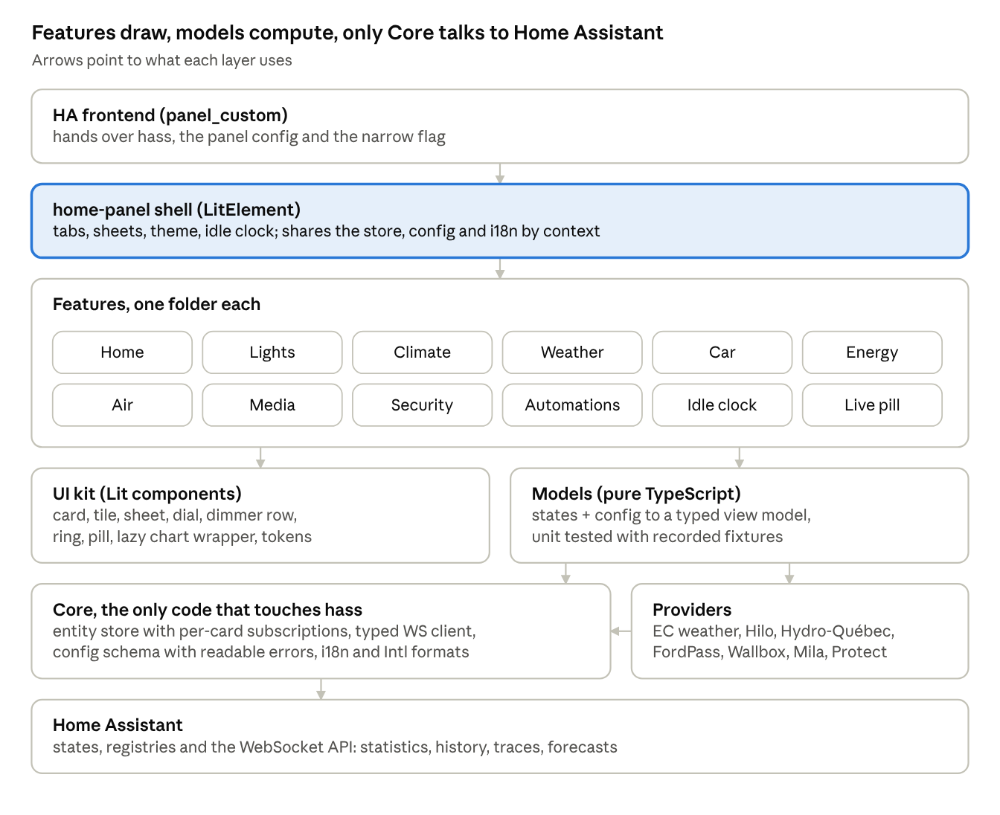
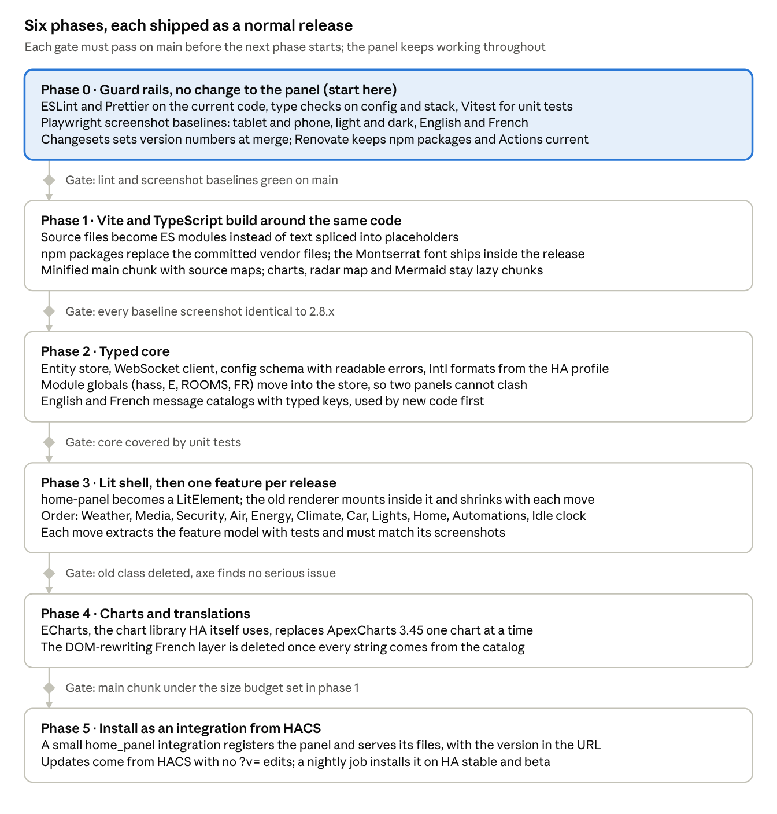

# Home panel: making it production grade

> Moved from the Claude artifact [Fuy1DvsAchZQwL3spDNLHt](https://claude.ai/artifact/Fuy1DvsAchZQwL3spDNLHt), first published 2026-11-07.

Nov 7, 2026

## Short answer

Yes to TypeScript, no to Vue. The panel should move to **TypeScript with Lit**, the same stack Home Assistant's own frontend runs on (Lit 3.3, TypeScript, Vitest, Playwright, ECharts). Vue would work, but it would fight Home Assistant instead of fitting into it.

The code isn't amateur. It already has a build, a tested pure config layer, a made-up test house in Chromium, CI and tagged releases. What holds it back is structure: one 3,274-line class that renders HTML strings, no types or lint, and a French layer that rewrites the page after it's drawn. That structure is also why parallel threads keep colliding on version numbers and merges.

The fix is an incremental rewrite in six phases, each shipped as a normal release, so the panel never stops working and other threads keep shipping. The last phase packages it as a small integration installed from HACS, so updates stop needing `?v=` edits.

## What the code base looks like today

The panel works and is tested at the edges, but nearly all of it lives in one class with no module boundaries. Measured on `main` at 2.8.1 (commit 459e1ac).

Already in place, and worth keeping:

- A build (`build.mjs`) that produces one ES module plus lazy-loaded chart, map and diagram libraries.

- A pure, unit-tested config resolver (`src/config.js`) and smart-stack ranking (`src/stack.js`).

- An end-to-end smoke test that loads the real bundle in Chromium against a made-up house, on tablet and phone, in English and French, and fails on any page error.

- A test that blocks personal data (names, IPs, house entity ids) from the public repo.

- CI on every PR, a tag-driven release workflow, vendored library licences documented, aria roles and keyboard handling, reduced-motion support.

What limits it:

| Area | Today | Why it matters |
|---|---|---|
| Structure | `src/home-panel.src.js` is 3,274 lines (331 KB). One `HomePanel` class holds about 200 methods and 95 instance fields | Every change touches the same file, so parallel branches conflict and get renumbered (2.6.0 became 2.7.0 on 7 Nov) |
| Readability | 111 lines are over 300 characters, the longest 855 | Hard to review in a diff, easy to hide a bug in |
| Shared state | `hass`, `TZ`, `FR`, `E`, `ROOMS` and others are module-level variables | Two panels on one page would overwrite each other; anything can change anything |
| Rendering | HTML strings written with `innerHTML` in 52 places, escaped by hand with `esc()` 198 times | One missed `esc()` on a media title or calendar event is a script injection. Replaced DOM loses focus and slider state, hence workarounds like `lightDrag` and catching Escape on `window` |
| Update cost | Any `hass` change re-runs 13 render functions (throttled to once a second) and diffs strings per container | Wasted work on a wall tablet that runs all day |
| Translation | French rewrites every text node after it's drawn, through a MutationObserver and regex patterns over English text (423-line map) | A reworded English string silently stops translating, and a third language means more patterns. Dates are formatted as `en-CA` for everyone |
| Types and lint | None. A regex test checks that called methods exist | A type checker catches that and much more |
| Build | Source files are spliced into placeholders as text. The 571 KB bundle (169 KB gzipped) is not minified and has no source maps | Stack traces point into a 4,386-line file; no tree shaking |
| Dependencies | ApexCharts, Leaflet and Mermaid (2.5 MB) are committed as minified files | Nothing tells you about security fixes; ApexCharts is frozen at 3.45.2 for licence reasons |
| Privacy | Montserrat loads from Google Fonts at runtime | Every wall tablet calls Google, and the font fails offline |
| Tests | 30 unit tests, mostly config. The smoke test checks that panes appear, not what they show | Logic inside the class (live activities, energy split, lights) has no tests |
| Releases | Version picked by hand in each branch. Install means copying files, editing `?v=` and restarting HA | Collisions between threads, and a manual cache-busting step |

## Language and framework options

TypeScript is the language: the panel runs inside Home Assistant's frontend in the browser, so anything that doesn't compile to plain JavaScript web components (Rust to WebAssembly, Elm, Dart) only adds a bridge. The real choice is the framework, and Lit wins on fit with Home Assistant. Runtime sizes are approximate, minified and gzipped.

| Option | Fit with Home Assistant | Runtime added | Verdict |
|---|---|---|---|
| **TypeScript + Lit** | What HA's frontend and most HACS cards use. Panels are web components receiving a `hass` property, which is Lit's native model. Can use HA's own elements and styles | about 6 KB | **Recommended** |
| Plain JS + JSDoc types | No new runtime; `tsc --checkJs` type-checks comments | none | Good first step (phase 0), not an end state: still string rendering |
| Vue 3 | Works through `defineCustomElement`, but reactivity has to wrap a `hass` object HA replaces on every state change, styles must be inlined into the shadow root, and HA's elements and community examples don't apply | about 35 KB | Possible, works against the grain |
| Svelte 5 | Compiles to custom elements with a tiny runtime; good performance | small | Viable, but a second mental model next to HA and fewer HA examples |
| React or Preact | Preact is tiny; React is large. Both render into a custom element by hand | 4 KB to 45 KB | No advantage here |

Why Lit specifically:

- Templates escape by default, which removes the `esc()` class of bugs.

- Lit re-renders only the parts whose values changed and keeps DOM nodes, so focus, sliders and scroll survive updates without workarounds.

- A card can declare which entities it reads and skip updates when none changed.

- The same tools HA uses apply directly: `lit-analyzer` type-checks templates, `eslint-plugin-lit` lints them.

## Recommended architecture

Split the panel into layers: features draw, pure models compute, and only a small core talks to Home Assistant. Integration-specific knowledge (Hilo, Environment Canada, FordPass) moves into providers so other houses can plug in theirs.

The shell is the one element HA loads; providers turn integration-specific entities into the generic inputs the models expect.

    src/
      main.ts                  defines <home-panel>
      shell/                   tabs, sheets, theme, idle clock, settings popup
      core/
        store.ts               entity store, per-card subscriptions
        api.ts                 typed WebSocket calls: statistics, history, traces, forecasts, system data
        config.ts              config schema, defaults, readable errors
        i18n/                  en.ts, fr.ts message catalogs, Intl formatters from the HA profile
        settings.ts            versioned per-browser settings (theme, wallpaper, text size)
      providers/               environment-canada, hilo, hydro-quebec, fordpass, wallbox, mila, unifi-protect, adaptive-lighting
      features/
        lights/                model.ts (pure), lights-pane.ts, dimmer-row.ts, light-sheet.ts, styles.ts
        climate/  weather/  energy/  car/  air/  media/  security/  automations/  idle/  live/
      ui/                      card, tile, sheet, dial, ring, pill, chart wrapper, design tokens
    test/
      fixtures/                anonymised state snapshots
      unit/  e2e/  visual/

Key choices:

- **Models are pure functions.** For example `lightsModel(states, registries, config)` returns the light rows. They hold today's logic, get unit tests with recorded fixtures, and know nothing about the DOM.

- **The store replaces module globals.** The shell receives `hass` and hands a store to its children through `@lit/context`. Each card declares the entity ids it reads, so a thermostat change doesn't redraw the car.

- **Config gets a schema.** A typo in `configuration.yaml` shows a card naming the bad key instead of a silently missing section.

- **Translation moves into the code.** Every string goes through `t('lights.count', {n})` with typed keys, and dates and numbers through `Intl` with the user's HA locale and 12 or 24-hour setting. A test fails when French is missing a key. Adding German becomes one file.

- **Heavy libraries stay lazy.** Charts, the radar map and Mermaid load as separate chunks when a tab needs them. Charts move to ECharts later (Apache-2.0, already used by HA), which lifts the ApexCharts 3.x licence freeze.

- **The font ships with the panel.** Montserrat (OFL licence) is bundled, so tablets never call Google.

## Tooling, tests and CI

Mirror Home Assistant's frontend toolchain where it applies, and add screenshot baselines as the safety net for the rewrite.

| Tool | Job | Replaces |
|---|---|---|
| TypeScript, strict mode | Types for `hass`, states and WebSocket replies (from `home-assistant-js-websocket`) | The regex "methods exist" test |
| Vite (library build) | ES module entry plus lazy chunks, minified, with source maps | `build.mjs` text splicing |
| ESLint with typescript-eslint and eslint-plugin-lit, Prettier, lit-analyzer | Lint, format and type-check templates, the same trio HA runs | Nothing today |
| Vitest | Unit tests for models, providers, config, i18n, against recorded fixtures | `node:test` |
| Playwright Test | Today's made-up house, plus `toHaveScreenshot` baselines for tablet and phone, light and dark, English and French | The smoke script and manual screenshot checks |
| axe-core for Playwright | Accessibility checks on every tab and sheet | Manual HIG reviews |
| Real Home Assistant in Docker | Nightly: HA stable and beta with demo entities and the panel installed; Playwright signs in and opens every tab | Nothing: catches HA frontend changes before an update reaches the house |
| size-limit | Fails a PR that grows the main chunk past its budget | Nothing |
| Changesets | Each PR states patch, minor or major; the version and changelog are computed at merge | Version numbers chosen per branch |
| Renovate, CodeQL, actions pinned by commit | Dependency and security updates | Committed vendor files nobody watches |

A fixture script exports states and registries from a real HA, swaps names, places and ids for made-up ones, and saves them under `test/fixtures/`. The existing personal-data test then guards those files too.

The PR pipeline runs in this order: lint and type check, unit tests, build and size check, then end-to-end, screenshots and accessibility. The real-HA job runs nightly and before each release. CI stays on GitHub-hosted runners, as decided on 7 Nov.

## Packaging and release

Ship the panel inside a small custom integration installed from HACS. It's the only option that removes the `?v=` edit and the YAML block, and it's how panels like Alarmo install themselves.

| Option | How a user installs and updates | Cache busting | Verdict |
|---|---|---|---|
| Today: release zip | Unzip into `www/home-panel/`, add `panel_custom:` YAML, restart | Edit `?v=` by hand, then restart | Fine for one house |
| HACS Dashboard (plugin) repo | HACS downloads the JS into `www/community/`; the user still writes the `panel_custom:` YAML. The file must be named after the repo (`ha-home-panel.js`) | Still manual | Small step, little gain |
| **HACS integration** (`custom_components/home_panel/`) | Add from HACS, then Settings → Add integration. It serves the built files and calls `panel_custom.async_register_panel` with the version in `module_url` | Automatic | **Recommended** |

The integration is about 100 lines of Python plus the built frontend. It can keep accepting today's `config:` block as YAML at first, and later store settings itself so an admin edits them from the panel's gear menu. Its CI adds the HACS and hassfest validation actions.

For your own house, the infrastructure repo then pins an integration version instead of copying a bundle, and an update becomes "update in HACS, restart".

## Migration plan

Rewrite in place, one release at a time, rather than a big-bang version 3: roughly 20 to 25 PRs over six phases, and the live panel never goes dark. Phase 0 changes no behaviour and can start now.

The screenshot baselines from phase 0 are the contract: a move that changes a pixel either gets fixed or gets a new baseline you approve.

Working alongside the other panel threads:

- Until a feature moves in phase 3, its fixes and new work go into the old code as today, and the move PR rebases on top of them.

- Each feature move is one small PR on its own folder, so it rarely conflicts with work elsewhere.

- Changesets ends hand-picked version numbers, so two threads no longer both ship the same number.

- Each phase lands as its own PR that you merge, like every panel change.

## Decisions for you, and risks

Four choices are yours; the recommendation is the first option in each.

- [ ] Framework: TypeScript and Lit, or Vue.

- [ ] Start phase 0 now (no visible change), or wait until the current wave of features settles.

- [ ] Packaging: a HACS integration in phase 5, or keep the zip and YAML.

- [ ] During phase 3, keep shipping features in parallel (slower migration), or pause new features for a few weeks (faster).

| Risk | Mitigation |
|---|---|
| A migrated tab looks or behaves slightly differently | Screenshot baselines per tab, theme and language; every diff is fixed or approved by you |
| Parallel threads keep editing the old class during phase 3 | One feature per PR, moved in an announced order; new work goes where the feature lives at that moment |
| The migration stalls halfway, leaving two styles | Each phase ends in a working, released panel; the old renderer only shrinks |
| An HA update changes the `hass` object or a WebSocket reply | Types catch shape changes at build time; the nightly real-HA job tests stable and beta |
| Bundle grows with new libraries | size-limit budget in CI; Lit adds about 6 KB; heavy libraries stay lazy |

## Sources

- [Home Assistant frontend package.json](https://raw.githubusercontent.com/home-assistant/frontend/dev/package.json): Lit 3.3.3, TypeScript, rspack, Vitest, Playwright, ESLint, Prettier, lit-analyzer, ECharts 6.1.0, intl-messageformat.

- [HACS: publishing a Dashboard (plugin)](https://hacs.xyz/docs/publish/plugin/): file naming and `dist/` rules.

- [HACS: publishing an integration](https://hacs.xyz/docs/publish/integration/): `custom_components/` layout and manifest keys.

- [How to add a sidebar panel to an integration](https://community.home-assistant.io/t/how-to-add-a-sidebar-panel-to-a-home-assistant-integration/981585): `async_register_static_paths` and `panel_custom.async_register_panel`.

- Code measurements: [pldelisle/ha-home-panel](https://github.com/pldelisle/ha-home-panel) at commit 459e1ac (2.8.1).
