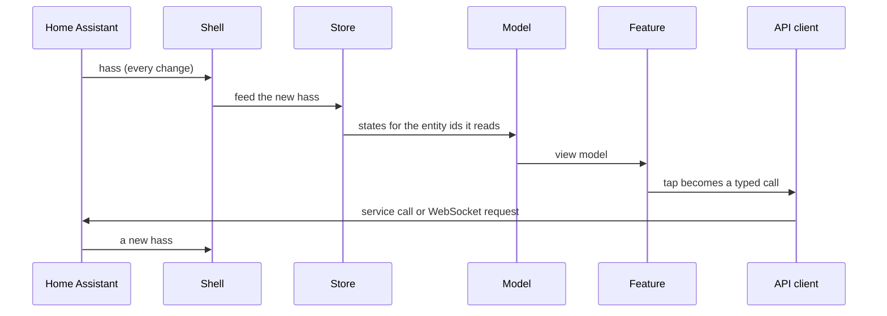

# Architecture

One page on where code goes and why. The words it uses (pane, sheet, tile, store, seam, adapter, house rule, display name) are defined in [CONTEXT.md](../CONTEXT.md). The reasoning behind each choice is in the [decision records](adr/README.md) and, for the plan as a whole, in the [programme spec](specs/production-grade-refactor.md) and [spec 09](specs/09-architecture-foundations.md).

Part of this is built and part is planned. The layer rules, the generated graph and the footprint number exist today. The store, the API client, the catalogs and the formatters are phase 2 work, the shell's steps so far (the Lit host and its guest, the registry and the frame, the appearance and the idle timer, and the phone's More sheet and the settings popup, its first elements with a shadow root of their own) are built, and the providers, the rest of the UI kit and the features are phase 3. Where a section describes something not yet built, it says so and names the spec.

## 1. Layers and the dependency rule

The layers are folders under `src/`. Dependencies point inward, toward the core. This is Robert C. Martin's Dependency Rule, the same shape as Cockburn's hexagonal architecture and Bernhardt's functional core, imperative shell (see the [reading list](#6-reading-list)). The reason is stated in [ADR 0011](adr/0011-layered-architecture-dependency-rule.md): features draw, models compute, only the core talks to Home Assistant.

| Layer                         | Folder                                                                                                                                                                                                                                                                                           | May import                                                                                     | Must not import                                                                                                                                              |
| ----------------------------- | ------------------------------------------------------------------------------------------------------------------------------------------------------------------------------------------------------------------------------------------------------------------------------------------------ | ---------------------------------------------------------------------------------------------- | ------------------------------------------------------------------------------------------------------------------------------------------------------------ |
| Core (functional core)        | `src/core/`                                                                                                                                                                                                                                                                                      | `src/core/`, npm packages                                                                      | anything else in `src/`; the DOM (`document`, `window`, `localStorage`, `navigator`)                                                                         |
| Providers                     | `src/providers/` (phase 3)                                                                                                                                                                                                                                                                       | `src/core/`                                                                                    | features, UI kit, shell, legacy                                                                                                                              |
| UI kit                        | `src/ui/` (built: icons, contexts, controllers, the stat tile, the pane header, the command layer, the switch, the stepper and the segmented control, the stylesheets: [ADR 0019](adr/0019-elements-in-their-own-shadow-roots.md), [ADR 0023](adr/0023-commands-and-shared-optimistic-store.md)) | `src/core/` (tokens, types), `lit`                                                             | features, providers, shell, legacy                                                                                                                           |
| Features (one folder each)    | `src/features/<name>/` (phase 3)                                                                                                                                                                                                                                                                 | `src/core/`, `src/ui/`, `src/providers/`, `lit`                                                | another feature's folder, the shell, legacy                                                                                                                  |
| Shell (imperative shell)      | `src/shell/` (built: steps B and C of [spec 14](specs/14-lit-shell.md)), `src/main.js`                                                                                                                                                                                                           | everything                                                                                     | nothing forbidden; it is the composition root                                                                                                                |
| Legacy (the strangler's host) | `src/home-panel.js`, `src/auto.js`, `src/i18n/fr.js`, `src/legacy/`, `src/styles.js`, `src/css/`, `src/fonts.js`, `src/stack.js`                                                                                                                                                                 | `src/core/`, `src/providers/` ([ADR 0025](adr/0025-shared-reads-live-in-providers.md)), legacy | features, UI kit (except `src/styles.js`, which joins `src/ui/styles/*.css`: ADR 0019), shell. Nothing imports legacy except `src/main.js` and legacy itself |

The rules live in one place, [`.dependency-cruiser.cjs`](../.dependency-cruiser.cjs), one rule per row with a comment saying why. Beyond the table it forbids import cycles, modules nothing imports and imports that resolve to nothing. `npm run lint` runs it after ESLint, so a forbidden import fails the build and CI's lint job needs no extra step. An ESLint block also bans `document`, `window`, `localStorage`, `navigator` and similar globals in `src/core/`: a core module that needs the time zone, the locale or a `Storage` takes it as a parameter, which is what lets the core run in Node with no browser.

The shell's folder holds the host element, the guest interface, the registry of the ten subjects ([ADR 0017](adr/0017-feature-registry.md)), the idle timer and the appearance controller with its pure rules (`appearance.ts`, `appearance-rules.ts`, `sky.ts`), whose value the shell provides by context ([ADR 0018](adr/0018-context-and-reactive-controllers.md)), and `document-background.ts`, the one place that writes the document's background; it keeps the shell's second piece of module state, the claims on each document, beside the guest registry ([ADR 0016](adr/0016-one-element-one-shadow-root-guest.md)); `more-sheet.ts`, the phone's More sheet, an element drawn from the registry that composes the kit's `<hp-sheet>`; `settings-popup.ts`, the popup behind the gear, an element that writes the settings; `sheet-host.ts`, the mediator that owns which sheet is open, Escape and focus return ([ADR 0021](adr/0021-one-sheet-host.md)); the kit's folder holds the icons, the contexts, the events an element sends up (`events.ts`), the controllers (`StoreController`, `MediaQueryController`, `AppearanceConsumer`, `SwipeToClose`), `<hp-pane-header>`, `<hp-sheet>`, `<hp-stat-tile>` and the stylesheets (`src/ui/styles/`, [ADR 0019](adr/0019-elements-in-their-own-shadow-roots.md)); `src/providers/` and `src/features/weather/` hold the first weather sources and model ([ADR 0020](adr/0020-weather-source-strategies.md)). The rules name every folder so they apply from its first file.

The module graph is drawn from the code, not from a slide: see [the dependency graph](architecture/dependency-graph.md). `npm run arch:graph` regenerates it, and a unit test fails when the committed file is stale, so do not edit it by hand.

One detail about the legacy row. The legacy set, written once in [`scripts/legacy-set.cjs`](../scripts/legacy-set.cjs), excludes `src/main.js`. That file is the shell's entry, the one module allowed to import legacy code, so it is not itself legacy. `npm run lint` ends by printing the legacy footprint, the number of modules the set still holds (see [the strangler fig](#4-the-strangler-fig)).

## 2. One-way flow

Data goes one way, and a change of mind goes round the whole loop.

1. Home Assistant hands the panel a `hass` object and sets it again every time something changes.
2. The shell receives `hass` and feeds the store.
3. The store holds the current `hass`, the resolved config, the user's locale and the formatters. It tells a subscriber only when one of the entity ids that subscriber reads has changed.
4. Models compute view models from what the store holds. A model is a pure function: `model(states, registries, config, now) → view model`.
5. Features render the view models. A tile is one of the compact blocks they draw.
6. A tap becomes a call through the API client, the one module that talks to Home Assistant's WebSocket.
7. Home Assistant acts, and answers by handing the shell a new `hass`. The loop starts again at step 1.



The panel never writes to `hass`. `hass` is Home Assistant's, and the panel treats it as a value to read. Three reasons, each from the specs:

- The store skips work by comparing state objects by reference between two `hass` objects, which is how Home Assistant's own cards do it (see _Frontend data_ in the [reading list](#6-reading-list)). A state object changed in place would defeat that check.
- Models take values and return values, with no DOM and no `hass` methods (the programme spec, phase 3). That is what makes them testable by calling them.
- Tests cross the panel at two seams: they hand it a `hass`, as Home Assistant does, or they call a pure function ([ADR 0005](adr/0005-two-seams-for-tests.md)). A panel that wrote to `hass` would have a third, hidden channel.

The shape is the Elm and Flux one of unidirectional data flow. The store is [spec 10](specs/10-entity-store.md), the API client is [spec 12](specs/12-api-client.md) and the shell is [spec 14](specs/14-lit-shell.md): `<home-panel>` is a `LitElement` that receives `hass`, feeds the store and then tells the legacy class, which is its guest and receives no `hass` of its own.

## 3. Where does this go?

| You are writing                   | It goes in                                                                       |
| --------------------------------- | -------------------------------------------------------------------------------- |
| A rule about a thermostat's state | A model (a pure function in the feature's folder)                                |
| A Hilo-specific entity name       | A provider (`src/providers/`)                                                    |
| A WebSocket message               | The core API client (`src/core/`; [spec 12](specs/12-api-client.md))             |
| A colour                          | UI kit tokens (`src/ui/`)                                                        |
| A string                          | The catalog, read through `t()` ([spec 11](specs/11-catalogs-and-formatters.md)) |
| A DOM event                       | The feature's element                                                            |

Two reminders from the same specs. A provider is an adapter in `src/providers/` whose `read` is a pure function turning an integration's entities into the generic inputs the models expect; a feature can have several, applied in a declared order ([ADR 0020](adr/0020-weather-source-strategies.md)), so a model never matches on an integration's entity naming (the anti-corruption layer of Evans). A reading that two features, or a feature and the legacy panel, need is a provider too, whatever it is named after ([ADR 0025](adr/0025-shared-reads-live-in-providers.md)). And a name a person gave in Home Assistant is data, not a code string: it goes through the display-name resolver, not the catalog ([spec 11](specs/11-catalogs-and-formatters.md)).

If two features need the same code, it cannot be shared sideways. It moves down into the UI kit, a provider or the core ([ADR 0011](adr/0011-layered-architecture-dependency-rule.md)).

### Anatomy of a feature

A feature is one subject of the panel in one folder, `src/features/<name>/`, plus one line in the registry. The recipe a move follows, from [spec 14](specs/14-lit-shell.md), "What a move must do":

1. Providers for what is integration-specific ([ADR 0020](adr/0020-weather-source-strategies.md)).
2. `ids(config)` and `model(inputs, deps)` in the feature's folder, pure, tested against the test house and a recorded fixture.
3. The elements, humble: a `StoreController` for the entities the model names, an `AppearanceConsumer`, lists keyed with `repeat`, strings through `t()`, numbers and times through the formatters.
4. The feature's own styles, split out of `src/css/` into one file of its own, and what it shares with other features moved down into the kit: one rule in one file, in the legacy form (`.app.cp`), which `forShadow` reads as `:host([compact])` for the element, so the prefix is never rewritten by hand.
5. The registry's `legacyFeature(key, ...)` line replaced by the feature's own descriptor.
6. The legacy class's methods, its `wire()` branches, its sheet markup and its entries of the French map deleted.
7. Every baseline unchanged, the behaviour specs moved to the feature's own spec, a mutation test for an unrelated change.

The kit, as the first element of the new layers left it:

| Where                                                                               | What                                                                                                                                                                                                                                                                                                                                                                                                                                                                                                                                                                                                                                                                                                                                                                                                                                                                                                                                                                                                                                                 |
| ----------------------------------------------------------------------------------- | ---------------------------------------------------------------------------------------------------------------------------------------------------------------------------------------------------------------------------------------------------------------------------------------------------------------------------------------------------------------------------------------------------------------------------------------------------------------------------------------------------------------------------------------------------------------------------------------------------------------------------------------------------------------------------------------------------------------------------------------------------------------------------------------------------------------------------------------------------------------------------------------------------------------------------------------------------------------------------------------------------------------------------------------------------- |
| `src/ui/styles/*.css`                                                               | The kit's rules, one rule in one file: `tokens`, `common`, `motion`, `sheet`, `badge`, `pane-header`, `stat-tile`, `more`, `seg` (the segmented control, which `<hp-seg>` and the settings popup adopt in their own roots and the Car pane draws in the guest until #253), `button` (the pill button `.abtn` and its `armed` ring, which `<hp-climate-controls>` adopts and the Car pane draws in the guest until #250 moves it; #253 deletes the legacy rules), `range` (the range tabs, which every sheet with a history draws), `settings`, `tiles` and `inner` (the detail panels' wells and cards, and the line a card says while it waits, which the guest's sheets draw too), `list` (the rows and chips of a status list: `.att`, `.arow`, `.clear` and the tint `.ic.acc`, which `<hp-car-ford>` and `<hp-car-status>` adopt and the guest's Status checks popup still draws, until the live pill's move, #256) and `chart` (a legend and the tooltip's face). `src/styles.js` joins them into the legacy sheet, each where its rules were. |
| `src/ui/*.element.css`, `src/shell/*.element.css`, `src/features/*/*.element.css`   | An element's own rules, in a file next to it: its `:host` and what only its tree has, never a template's `css` block. Only that element adopts it (through `forShadow`, last in its `styles`), `src/styles.js` does not join it, and `test/unit/styles-split.test.mjs` reads it: its selectors may not be written in any other kind of file, and its `:host` rules are each root's own.                                                                                                                                                                                                                                                                                                                                                                                                                                                                                                                                                                                                                                                              |
| `src/ui/styles/index.ts`, `host.ts`                                                 | What an element adopts: the same text, with `.app.cp` read as `:host([compact])` (`forShadow`).                                                                                                                                                                                                                                                                                                                                                                                                                                                                                                                                                                                                                                                                                                                                                                                                                                                                                                                                                      |
| `src/ui/controllers/appearance-consumer.ts`                                         | Reflects `data-theme`, `compact`, `narrow`, `glass` and `large-text` on an element, from the appearance the shell provides.                                                                                                                                                                                                                                                                                                                                                                                                                                                                                                                                                                                                                                                                                                                                                                                                                                                                                                                          |
| `src/ui/controllers/tick.ts`                                                        | `TickController(host, ms, active)`: one interval per host, started in `hostConnected`, cleared in `hostDisconnected`, calling `requestUpdate()` only while `active()` says so. Its three users: Security's camera snapshots (a ten-second stamp), the "ago" lines (Weather's observation, the scenes' "Last 2 h ago") and the idle clock.                                                                                                                                                                                                                                                                                                                                                                                                                                                                                                                                                                                                                                                                                                            |
| `src/ui/stat-tile.ts`, `src/shell/more-sheet.ts`, `src/shell/settings-popup.ts`     | The first three elements with a shadow root of their own: properties down, `tile-open`, `tab-select`, `sheet-close` and `sleep-now` up. The popup also writes the settings (the shell's controller applies them).                                                                                                                                                                                                                                                                                                                                                                                                                                                                                                                                                                                                                                                                                                                                                                                                                                    |
| `src/ui/pane-header.ts`, `src/ui/lens.ts`                                           | The header every pane opens with: `icon`, `color` and `heading` down, and slots for what the guest writes (`sub`, `actions`, a `title` it writes) and for an icon drawn in colour (`icon`, the weather's). The Mercury drop's filter for an element's own root.                                                                                                                                                                                                                                                                                                                                                                                                                                                                                                                                                                                                                                                                                                                                                                                      |
| `src/ui/sheet.ts`                                                                   | The kit's sheet: `open` and `inline` down, `sheet-close` up, the pane header for its header, slots for the sub-line (no line drawn when none is slotted), the tabs, the actions and the body.                                                                                                                                                                                                                                                                                                                                                                                                                                                                                                                                                                                                                                                                                                                                                                                                                                                        |
| `src/ui/chart.ts`, `src/ui/chart-options.ts`, `src/core/apex.ts`                    | `<hp-chart>`: `options` and `height` down, one ApexCharts instance in its own root, `updateOptions` on a change, a new instance only for a new theme or language, `destroy` on disconnect, a `ToastEvent` when the chunk fails, once for all the charts (a microtask latch: the kit's one piece of module state besides the loader's promise) ([ADR 0022](adr/0022-hp-chart-wraps-apexcharts.md)).                                                                                                                                                                                                                                                                                                                                                                                                                                                                                                                                                                                                                                                   |
| `src/ui/range-tabs.ts`, `src/ui/ranges.ts`                                          | `<hp-range-tabs>`: `ranges` (the tabs and their words) and `value` down, `range-change` up, the legacy `.tabs[role=tablist] > .tab[role=tab]` markup. `RANGES`: the four ranges (a day, a week, a month, a year) as data (span, statistics period, bucket, message keys, ticks, tooltip format) for every sheet with a history; the class's `CRANGE`, its duplicate, went with Climate's charts (#246).                                                                                                                                                                                                                                                                                                                                                                                                                                                                                                                                                                                                                                              |
| `src/ui/commands.ts`, `src/ui/overlay-store.ts`, `src/ui/controllers/optimistic.ts` | The command layer ([ADR 0023](adr/0023-commands-and-shared-optimistic-store.md)): `CommandRunner`, the Command's invoker (`Command`, `Call` and `overlayKey` are data in `src/core/commands.ts` and `src/core/overlay-key.ts`, so a provider can write commands) (sends a `Command`, toasts, and on failure releases only its own `holds` and toasts sticky); `OverlayStore` and the pure `overlay`, the held values (the legacy `pend` rule), one store per panel provided by `optimisticContext`; `OptimisticController`, an element's subscriber, with one timer at the earliest expiry.                                                                                                                                                                                                                                                                                                                                                                                                                                                          |
| `src/ui/switch.ts`, `src/ui/switch.element.css`                                     | `<hp-switch>`: `checked` (reflected), `disabled` and `label` down, a composed `change` with `detail.checked` up; it never flips itself, its owner holds the optimistic value. Its look copies the legacy `.sw` rules until #263 deletes them.                                                                                                                                                                                                                                                                                                                                                                                                                                                                                                                                                                                                                                                                                                                                                                                                        |
| `src/ui/stepper.ts`, `src/ui/stepper.element.css`, `src/ui/steps.ts`                | `<hp-stepper>`: `value`, `label` (the small word under it), `min`, `max`, `step`, `decrementLabel`, `incrementLabel`, `disabled` and `valueText` down, `step-change` with `detail.value` (the next value, rounded to the step's decimals and kept in `min` to `max`, by the pure `stepBy`) up; the buttons are disabled at the bounds, it never holds the value, its owner debounces and sends. Promoted from Media's speaker pod for Air's fan speed, with the climate setpoint (spec 20) the third; the owner sizes the host with `flex`, `order` and `padding`, and the buttons and the value through `part="button"` and `part="value"`. Climate's room setpoint, heat pump target and "set every room" are its third to fifth users (#248), the first two not drawn on a phone, where the dial sets them; its look is the legacy `.stepper` rules' own, which #248 deleted.                                                                                                                                                                     |
| `src/ui/seg.ts`, `src/ui/seg-keys.ts`, `src/ui/seg.element.css`                     | `<hp-seg>`: `options` (`{value, label, sub?, disabled?}`), `value`, `label` (the group's aria text) and `disabled` down, `change` with `detail.value` up; the legacy `.seg[role=radiogroup] > button[role=radio]` markup with the WAI-ARIA radio group's keys (one tab stop on the chosen option, the arrows, Home and End move the choice and the focus), decided by the pure `moveTo` and `tabStop`; it never holds the value, its owner does. The group (`part="group"`) and each word (`part="label"`) are parts an owner sizes from outside. Air's mode and metric groups and Climate's heat pump groups (#248) use it; Car's are next (#253).                                                                                                                                                                                                                                                                                                                                                                                                  |
| `src/ui/controllers/armed.ts`                                                       | `ArmedController(host, {ms})`: `arm(key)`, `isArmed(key)`, `confirm(key)` (true when the key was armed, and clears it), `clear()` (every arming lapses at once: a stepper moved, another button was armed); one timer per key lapses after four seconds and updates the host, all cleared in `hostDisconnected`. The second tap of Climate's "all" buttons (#248) and of Car's remote start (#250).                                                                                                                                                                                                                                                                                                                                                                                                                                                                                                                                                                                                                                                  |
| `src/ui/controllers/windowed-history.ts`                                            | `WindowedHistory(host, deps, {windows, derive, tag})`: a feature's statistics windows through the panel's cache when its host is `active` ([ADR 0028](adr/0028-history-on-demand-one-cache.md)); `data` and `error`, kept fifteen minutes, a late reply dropped, a failure retried after a minute. Composition, not a base class: the owner (`EnergyHistory`, the Car's `CarHistory`) registers itself with the host and hands it the three hooks. Climate's loader keeps one entry per range and stays its own.                                                                                                                                                                                                                                                                                                                                                                                                                                                                                                                                     |
| `src/ui/icons.ts`, `src/ui/feature.ts`                                              | `ico(name, size)` and `weatherIcon(condition, size, day, label)`; the descriptor's type, in the kit so a feature can type its own (ADR 0017).                                                                                                                                                                                                                                                                                                                                                                                                                                                                                                                                                                                                                                                                                                                                                                                                                                                                                                        |
| `test/unit/styles-split.test.mjs`                                                   | Fails when a selector of a new layer is written in a second file.                                                                                                                                                                                                                                                                                                                                                                                                                                                                                                                                                                                                                                                                                                                                                                                                                                                                                                                                                                                    |

An element adopts the kit's sheets and nothing else: it never reads the legacy sheet, and the words it draws are catalog messages, because the French rewrite layer cannot see inside its root ([ADR 0019](adr/0019-elements-in-their-own-shadow-roots.md)).

#### The worked example: `src/features/weather/`

Weather is the first move, and its folder is the recipe laid out ([spec 15](specs/15-weather.md); the folder's own [README](../src/features/weather/README.md) lists the files):

| Step of the recipe | In `src/features/weather/` and beside it                                                                                                                                                                                                                                                                                                                                                                                                                                                                                                                                                                                                                                                                                                                                                                                                                                                                                                                   |
| ------------------ | ---------------------------------------------------------------------------------------------------------------------------------------------------------------------------------------------------------------------------------------------------------------------------------------------------------------------------------------------------------------------------------------------------------------------------------------------------------------------------------------------------------------------------------------------------------------------------------------------------------------------------------------------------------------------------------------------------------------------------------------------------------------------------------------------------------------------------------------------------------------------------------------------------------------------------------------------------------- |
| 1. Providers       | `src/providers/weather-entity.ts` and `environment-canada.ts`, two sources behind `WeatherSource`; Environment Canada's condition phrases are mapped to `weather.cond.ec.*` messages there.                                                                                                                                                                                                                                                                                                                                                                                                                                                                                                                                                                                                                                                                                                                                                                |
| 2. Ids and model   | `ids.ts`, `inputs.ts` (`readWeather`), `model.ts` (`weatherModel`, `weatherBrief`), `tiles.ts`: pure, at 100 percent in Vitest.                                                                                                                                                                                                                                                                                                                                                                                                                                                                                                                                                                                                                                                                                                                                                                                                                            |
| 3. The elements    | `weather-pane.ts`: `<hp-weather-pane>` runs the model in `willUpdate` and places the result; its `active` property pauses the store controller; it owns the statistics caches (the detail's, fifteen minutes, and a tile history's, ten) and draws the detail only while it is on screen. `weather-detail.ts`: `<hp-weather-detail>` places the model's detail blocks, the pure `history.ts` over the cache's rows and four `<hp-chart>`; `radar.ts` mounts the HACS card. `forecast-controller.ts` owns the forecast subscription for as long as the pane is connected. `weather-history.ts`: `<hp-weather-history>` is a tile's history in an `<hp-sheet>` with `<hp-range-tabs>`, one `<hp-chart>` and the low, mean and high of each line, from `tileHistory`, `tileStats` and `historyChartOptions`; the pane draws it only while the sheet host has `weather.history` open, so it asks for its statistics while connected and lets go on disconnect. |
| 4. Styles          | `styles.css`: the pane's and the detail's rules, in the legacy form, adopted through `forShadow`; each element's own `:host` rules are in `<element>.element.css` beside it; the stat tile's, the detail's wells', cards' and legend's are the kit's.                                                                                                                                                                                                                                                                                                                                                                                                                                                                                                                                                                                                                                                                                                      |
| 5. The registry    | `index.ts` exports `weatherFeature`; `FEATURES` lists it where `legacyFeature('weather', …)` was. The descriptor's type lives in `src/ui/feature.ts`, because a feature may not import the shell.                                                                                                                                                                                                                                                                                                                                                                                                                                                                                                                                                                                                                                                                                                                                                          |
| 6. Deletion        | The class lost `renderWeather`, `renderWxTiles`, the forecast subscription, the detail panel (`weatherSheet`, `renderWeatherNow`, `renderForecast`, `renderSeason`, `loadWxHistory`, the radar methods, the `#sh-weather` markup), the history sheet (`openWx`, `wxSheet`, `loadWx`, `wxDef`, `#sh-wx`, its tabs' wiring, `openWeatherHistory`) and their rules of its stylesheet and entries of the French map. What Home's card and the idle clock still read (`wxDays`, `dayName`, `alerts`, `sunDay`, `wxIcon`, `condName`, `this.fc`) stays, each with the move that deletes it; the shell tells the guest of a forecast.                                                                                                                                                                                                                                                                                                                             |
| 7. Proof           | `test/e2e/weather.spec.ts` (the phone: tiles, both languages, the forecast, the detail's sheet, mutation counts) and `weather-detail.spec.ts` (the tablet: the detail inline, the cache, the charts, the radar), `weather-history.spec.ts` (a tile's history on both: the ranges, the cache, Escape and the focus, one notification each), the French equivalence rows in `test/unit/fixtures/moved/weather.json`, the baselines unchanged.                                                                                                                                                                                                                                                                                                                                                                                                                                                                                                                |

Four habits the example shows. An element's detail is its pane's: the descriptor names `detailSheet`, a tablet shows the detail inline in the pane, and a phone opens it in `<hp-sheet>` over the screen, the pane staying in the page behind it when another tab asked, so the tab does not change. A hidden pane keeps what it drew: `willUpdate` skips the model while `active` is false, and the store controller is paused, so another tab costs nothing. A sheet over the screen that is not the detail is asked for by an event and drawn by the pane: the tile's `SheetRequestEvent` carries what to show (`{key}`), the sheet host keeps it with the open sheet (`detail(id)`, read through the descriptor's `env.sheetDetail`), the descriptor lists the id in `overSheets` so the pane stays in the page behind it on any tab, and the element exists only while it is open. A temporary member between the guest and an element (`forecastChanged`, the `ForecastEvent`) carries a note naming the move that deletes it.

Media's pane (#217) adds two habits for a move that lands in halves. A rule the legacy sheet still needs, because the guest still draws its markup somewhere, is copied into the element's own file under a selector of its own (`.mcard` for `.card`, `.tvhead` for `.mtvhead`, as `.switch` copies `.sw`), with a header naming the ticket that deletes the legacy rule; a computed-style comparison and the baselines prove the copy. And the descriptor's template keeps the guest's containers for the half not yet moved, after the element and as static markup Lit binds nothing in (Media's `#mtiles`, `#mtv` and `#media`, until #218 moved the phone's tiles), where `legacyFeature` used to write them. The phone's tiles (#218) are the second sheet over the screen asked for by an event: `<hp-media-tile>` asks for `media.controls` with its key, and the pane draws the card that key names in `<hp-sheet>`. The scenes row (#219) is the first element on a pane the guest still draws: the Home-card bridge ([ADR 0024](adr/0024-home-card-bridge.md)) lets the guest write `<hp-scene-tiles>` into `#hscenes` once per draw and nothing else, the element takes everything from context, and its `hp-empty` (`EmptyEvent`, `src/ui/events.ts`) is the one event the guest may hear from it; the use is listed in `src/shell/guest.ts`'s header with its deleting ticket, the Home move (spec 24, #268). The Home TV card was never a use: it was never on screen, and #219 deleted it. Media's move ended with #220: the legacy panel holds no Media code except `speakers()` and `tv()`, which its now-playing stack card still reads and #266 deletes with the legacy stack; `#hscenes` stays as the Home-card bridge's one host until the Home move. Security's pane (#224) follows the same habits: its two cards carry the legacy `.card` look on an inner box (a backdrop filter's lens is found from its own root, not a host's), and a tap on a camera or a sensor is a `SheetRequestEvent` for a sheet the pane draws (#225): `<hp-camera-sheet>`, whose live view is a mount module (`mountCameraStream`, after Weather's radar) and the one place a feature hands the raw `hass` object onward, and `<hp-sensor-history>`, read through a ten-minute statistics cache the pane owns; the legacy stack opens the same sheets through the sheet host until #266. The Home card (#226) is the bridge's second use: `<hp-security-card>` is written into `#hsec` once a draw, draws its own box on an inner element where the container (`display: contents`) takes none, copies the few legacy rules it needs under selectors of its own (`.seccard` for `.card`, `.chev` for `.go`, `.nosens` for `.hint`; `.lbl` and `.sic` inside its rows) until the Home move deletes them, glows from element state over `newlyActive` (one 2.8 second timer, cleared on disconnect), and asks the shell for the Security tab with a `tab-select` event the shell's frame hears ([ADR 0026](adr/0026-bridged-card-draws-its-own-box.md)). Security's move ended with #227: the legacy panel holds no Security code, only three readers of the provider (`doorMotionSensors`: the Status checks, the stack's door card and the More word), which word "Open for 12 min" with the legacy formatters until #254 (spec 22, the Status checks' rules) and #265 (spec 24, the stack's rules) move them, and the stack opens the sensor's sheet through the sheet host until #266. Air's pane (#232) is the first whose tablet tab was the legacy detail alone: the old summary card was parked in the hidden Home columns there, so `<hp-air-pane>` draws its header on a tablet without showing it and draws `<hp-air-card>` on a phone only, where the card's box is a button that asks for the detail's sheet; the card copies legacy rules under selectors of its own, each named in its CSS header: the climate list's `.rooms`/`.room` until #248 deletes them, and `.card`, `.top`, `.lbl`, `.state` and `.go` until #268 deletes them. The detail's move (#233) is the first with two elements and a control: `<hp-air-detail>` is the pane's `air.detail` (inline on a tablet, in `<hp-sheet>` on a phone), keeps no choice of its own (the pane owns the range and the metric, the ten-minute statistics cache and the model's overlay, and the detail tells a tap upward as `range-chosen` and `metric-chosen`, the sensor history's habit), and draws two `<hp-chart>`s from the pure `history.ts`; `<hp-air-room>` holds a tap in the panel's optimistic store and runs the command through `CommandRunner` (Media's), and its stepper's taps go through `debounce(900)`, cancelled in `disconnectedCallback` with the held speed released, so a burst is one `fan.set_percentage`. The legacy detail and its rules (`.aqcard`, `.aqsum`, `.aqrooms` and the rest) are gone; the two rules it copied from the legacy panel, `.state` (in both elements) and `.hint` (the room card's, as `.aqctl .hint`), are named in their CSS headers with #268, and the two radio groups are `<hp-seg>` (#247). Air's move ended with #234: the legacy panel holds no Air code but one reader, `airRooms()` (the provider's `milaRooms` and `rateRoom` over the store), which the stack's air card and the Home tile call and word with the legacy English until #266 and #268 move them; the More word is the descriptor's `airBrief`, and the legacy `.stepper` rules stay for the climate's own steppers until #248. Energy's move ended with #241: the legacy panel holds no Energy drawing, only readers of the providers over the store (`powerNow`, `hiloRates`, `hiloChallenge`, `hydroQuebec`: the header's peak chip, the stack's peak and Energy-today cards, the live pill, the Home tiles, Climate's rooms and the More word) and `loadSharedHistory`, which asks the panel-wide cache for the four power windows and keeps the hourly flow, the meter's totals and the water heater's day for the readers that still print them; the year of daily power is Energy's alone and is asked when the card first connects, not at start. The legacy `loadHistory` kept only Climate's and Car's windows after it, and ended with #251. Energy's pane (#239) is the first to draw a drawing with `svg` templates over pure geometry and the first whose history loads when it is shown: `<hp-power-flow>` places the numbers and texts of `flowLayout` and binds attributes, so the one `<svg>` is never rebuilt and a line that keeps its power keeps its dash animation, and `EnergyHistory` asks the panel's statistics cache (`statisticsCacheContext`, [ADR 0028](adr/0028-history-on-demand-one-cache.md)) when any part of the pane is on screen; the guest still asks the same cache for the power windows, so each is read once. The pane routes Home's phone Water heater tile to its own `energy.water` sheet (`overSheets`), so the card sheet (`sh-card`) and the legacy cards it moved are gone; `<hp-power-flow>` and the three cards copy legacy rules under selectors of their own (`.run`, `.pulse`, `.ebox`, `.ego`), each named in its CSS header with the ticket that deletes the legacy one (#268 for the card), and the hero's rules moved to the kit's `hero.css`. Energy's detail (#240) is the second element with a control the pane keeps state for, after Air's: `<hp-energy-detail>` is the pane's `energy.detail` (inline on a tablet, in `<hp-sheet>` on a phone), the pane owns the range and the Sankey's period for the panel's life, and the detail tells a tap upward as `range-chosen` and `mode-chosen`. Its charts are plain data from the pure `charts.ts` through `<hp-chart>`, rebuilt only when the history, the range, the theme, the language or the shape changed, so a power reading every second draws nothing again and a range tap asks the recorder for nothing; a range that changes the kind of chart (bars on a time axis, bars on categories) is `<hp-chart>`'s `shape`, which draws a new instance because the library merges new options into the old ones. The Sankey is the second drawing over pure geometry: `sankeyLayout` returns ribbons, bars and labels in paint order, `<hp-sankey>` places them keyed, and its Now period is `<hp-power-flow>` over the card's own geometry, so the live flow is laid out once. The legacy `.flow`, `.dash`, `.npulse`, `.donut`, `.totals`, `.sankey` and `.sk` rules went with the legacy detail. Climate's pane (#244) is the first element pane that slots the legacy panel's own drawing into its elements: `<hp-climate-pane>` is given three containers by its descriptor as static light DOM, `#cctl`, `#cchart` and `#chost`, and forwards them as named slots through `<hp-climate-detail>` (the legacy controls under the head and the legacy chart under the tiles) and under the grid (the legacy sheet's heatmap and outside chart, which the sheet host puts in `#chost` on a tablet), so the legacy code keeps its containers and listeners and the element draws everything around them. The pane keeps the room and the range for the panel's life and tells the shell through `ClimateDetailEvent`, which the shell hands the guest (`climateDetailChanged`), so the guest keeps no selection of its own; the guest tells the pane the two figures its history gives the Range and Heating tiles (`climate-figures`, dispatched on `#chost`, whose parent the pane is) until #246 loads the history in the feature. The list, the gauge and the dial are elements over pure geometry (`<hp-climate-list>` a listbox, `<hp-gauge>` and `<hp-dial>` placing `gaugeGeometry` and `dialGeometry` with `svg` templates), and the dial is an image until #248 (the legacy steppers show on the phone meanwhile); the state pill is `.cpill`, a copy of the legacy `.pill` that the Automations pane still draws. Car's pane (#251) is the second whose tablet tab is the legacy detail alone, after Air's: `<hp-car-pane>` draws a header and `<hp-car-card>` on a phone only and nothing on a tablet, where the sheet host puts the legacy detail inline in the pane's section; the card's tap asks for the legacy sheet by its own id (`sh-car`, a `SheetRequestEvent` the host opens as it did), so the descriptor has no `detailSheet` until #252. `CarHistory` asks its two windows when the pane is shown, and one of them, the Wallbox's year of hours (`sessionsWindow`, in the provider), is also in the guest's `loadSharedHistory`, which the legacy detail's sessions and the live pill read, through the same cache, so it is read once; the guest's `loadHistory`, `derive` and `this.H` are gone. The card copies the legacy rules it needs under selectors of its own (`.box` for `.card`, `.clbl`, `.cgo`), each named in its CSS header with the ticket that deletes the legacy rule (#268); the failed photo is its one state, `imageFailed`, for the element's life. Car's detail (#252) is Weather's shape with five blocks: `<hp-car-detail>` is the pane's `car.detail` (inline on a tablet with a header of its own, in `<hp-sheet>` on a phone, held only while open) and places `<hp-car-battery>`, `<hp-car-status>`, `<hp-car-sessions>`, `<hp-car-ford>` and `<hp-car-last-plug>`, each drawing its own `.inner` card over its model block, so a change of one entity redraws the one block that shows it and the legacy panel's one-second redraw of the sheet is gone. The battery bar and the picture are written once for the card and the battery block (`soc-bar.css`, `socBar`, `carArt`); the status block's chips and the Ford block's rows are the kit's `list.css`, shared with the Status checks popup; the table's button `.showall` is a known copy of the legacy `.more`, which the Lights header and the comfort controls still draw. The sessions table's length is the pane's state, asked for by a `sessions-toggle` event. The legacy charger and comfort cards stay in the guest until #253, in the way Climate's controls did: static light DOM of the pane (`#car-controls`), forwarded through the `controls` slot into the detail, with the guest's listeners on it, and the pane marking it `data-shown` and sending `car-detail-shown` while the detail is on screen, since the guest cannot see inside an element; no legacy sheet is inline any more, so the sheet host's inline placement is dead until the guest's deletion (#188).

## 4. The strangler fig

The panel is being rewritten in place, one feature per release, while it keeps running in the house ([ADR 0003](adr/0003-rewrite-in-place-strangler-fig.md)). The legacy code, the legacy set, is the host. It is the table's legacy row plus the files `scripts/legacy-set.cjs` adds to it (all of `src/i18n/` and the two declaration files) and minus `src/main.js`, the shell's entry. New layers grow around it and take over a feature at a time, until the legacy class is deleted. Fowler's _Strangler Fig Application_ names the shape, and _Parallel Change_ (expand, migrate, contract) names how a wide change such as removing the module globals stays mergeable.

How the set shrinks:

- A structural move changes no behaviour and no pixel. The screenshot baselines are the characterization tests that prove it ([ADR 0004](adr/0004-screenshot-baselines-are-the-contract.md)).
- Until a feature has moved, fixes and new work for it go into the legacy class and the move rebases on top. After it has moved, work goes into its folder.
- One feature moves per pull request. Each move extracts the model with unit tests against recorded fixtures, writes the Lit elements, subscribes only to the entity ids the model reads, and deletes the matching methods from the legacy class.
- The regular expression in `scripts/legacy-set.cjs` shrinks as modules move into a layer.
- The legacy class is the shell's guest ([ADR 0016](adr/0016-one-element-one-shadow-root-guest.md), [spec 14](specs/14-lit-shell.md)): `LegacyPanel` is no element. `src/main.js` registers it (`registerGuest`), the shell constructs it and hands it a `GuestContext` (the shell's one shadow root, the host element, the store, the API client, the settings), and drives it through `connect`, `disconnect`, `hassChanged`, `panelChanged`, `tabChanged`, `compactChanged`, `appearanceChanged`, `idleChanged`, `availability`, `moreLine` and `statisticsLoaded`. The shell draws the frame from the registry (`src/shell/features.ts`): the header's containers, the rail, the phone's bar and one pane per subject, whose content is the guest's until a move; it owns `tab`, `compact`, the idle state ([`IdleTimer`](../src/shell/idle-timer.ts), a state machine whose table is in its header) and which tabs the house shows. The guest draws into two containers of the shell's root, `<div class="guest" style="display:contents">` and the idle clock's `#iwrap` inside the overlay the shell draws, and the rule both sides keep is: Lit binds nothing inside a guest container, and the guest writes nothing outside its containers (inside one, by a listed exception, it may write a feature element's tag: the Home-card bridge of ADR 0024). The interface in `src/shell/guest.ts` only shrinks, except two members the settings popup added (`statisticsLoaded`, deleted with `loadHistory` in #182, and `closeSettings`, deleted with the Status checks' move in #183) and two the Weather pane added (`openWeatherHistory`, deleted with the history's move in #159, and `forecastChanged`, deleted with its last reader, the detail panel's move in #158 and Home's), and the file is deleted with the guest. The store, the API client and the settings reach the shell's future elements through context ([ADR 0018](adr/0018-context-and-reactive-controllers.md)).

The move order of phase 3 is fixed and announced in the changelog of the release that starts it:

1. Weather
2. Media
3. Security
4. Air
5. Energy
6. Climate
7. Car
8. Lights
9. Home
10. Automations
11. Idle clock

The live-activity pill and the Status checks move with the shell's header and are extracted as their own feature after Energy and Car, which they read. The shell comes first: from its first release the legacy class draws into a container inside it, and still draws every pane. The order starts with the features that have the least shared state (Weather, Media, Security, Air) and ends with the ones that read everything (Home, Automations, Idle clock), so the legacy class shrinks from its edges inward.

The footprint number is how many modules the legacy set still contains. `npm run lint` prints it as `legacy footprint: N modules`. It was 21 when this page was written. It counts files, declaration files included, so a move can lower it by more than one. A unit test also checks the other half of the rule: no module outside the legacy set imports a legacy module. The number is the progress figure of phase 3: it falls as modules move into a layer.

## 5. Coding conventions

**Module header.** Every module under `src/core/`, `src/providers/`, `src/ui/`, `src/features/` and `src/shell/` opens with a header comment of three to six lines: what the module is, the pattern it applies with its source in one phrase, and what it must not do. The legacy files are exempt. An illustration for a planned module:

```ts
// The entity store: holds the current hass, the config, the locale and the formatters.
// Pattern: the functional core, a deep module with a small interface (Bernhardt, Boundaries;
// Ousterhout, A Philosophy of Software Design).
// Must not: touch the DOM, call a hass method, or be imported as a singleton.
```

A pattern named in code uses the glossary's term, and the glossary uses the literature's name where there is one: seam, adapter, humble object, strangler fig.

**Parse, don't validate, at the edges.** Data from outside the panel (the config, a WebSocket reply, a `localStorage` read) is parsed into a typed value at the edge, once, and the rest of the code trusts the type. Problems are values, not exceptions, and the panel is a tolerant reader. The config schema is both the parser and the type ([spec 13](specs/13-config-schema.md)); replies are parsed in the API client, which rejects a stale reply ([spec 12](specs/12-api-client.md)). Source: King, _Parse, don't validate_.

**Pure models, with `now` passed in.** A model is a synchronous function from values to a view model, with no DOM and no `hass` methods. It does not read the clock: the caller passes `now`. Like the core's rule about the time zone, locale and storage, it accepts its dependencies and does not create them. This is why a model is tested by calling it with a recorded fixture.

**One test house.** A made-up house is data in `test/houses/` (`full.mjs`, `bare.mjs`: plain ES modules exporting `states`, `entities`, `devices`, `areas` and `automations`), never a literal in a test, in the harness or in a spec. It has two readers and no others: the harness (`test/e2e/harness.html`) serves it to the panel in the browser, and `fakeHass.fromHouse(house)` builds the fake `hass` of the unit tests from it, through the same reader (`test/houses/read.mjs`). A time that depends on the clock is a marker (`fromNow`, `nextAt`, `sunState` in `test/houses/clock.mjs`) that the reader resolves against the instant it is given: the page's clock in the harness, the reference instant (`REFERENCE_INSTANT`, also the e2e `AFTERNOON`) in Vitest, so a model test and a screenshot see the same house. A test that needs a different house changes the data, or passes an option to a reader (`frenchAreas`, `automations`); it does not build a second house. A recorded house is a fixture, a different thing: see the glossary.

**Recorded fixtures.** A model is also proven on the owner's real house, recorded once and anonymised: `test/unit/fixtures/houses/<name>.json`, with `{recordedAt, source, states, entities, devices, areas, statistics?}`. A test starts from one with `fakeHass.fromFixture(name)`, which builds the same `PanelHass` shape as `fromHouse`; the statistics, when recorded, answer `recorder/statistics_during_period` by period for the ids asked. The model never reads the clock, so a test passes `now` itself (`readFixture(name).recordedAt` is the recording's instant); a fixture recorded on one day works at any instant. To record or refresh one, the owner runs the recorder against their Home Assistant, never CI:

```sh
read -rs HASS_TOKEN && export HASS_TOKEN   # paste the long-lived access token; it is not echoed and stays out of the shell history
HASS_URL=http://<host>:8123 \
  npm run record:fixture -- --map ~/.config/home-panel/anonymise.json --out test/unit/fixtures/houses/main.json \
  [--statistics sensor.a,sensor.b]
```

The URL and the token come from the environment and from nowhere else. The mapping file (`{"entities": {"sensor.real_id": "sensor.made_up"}, "strings": {"Real Name": "Made Up"}}`) holds the real names, so it lives outside the repository, is the owner's, and is never committed; the script refuses a mapping that is inside the checkout. `scripts/lib/anonymise.mjs` (pure, 100 percent covered) applies the entity ids first (the domain is kept) and the strings next, longest first, also in their spelling as an id, rounds the coordinates to one decimal and drops the tokens, pictures, hardware ids and links to the installation; the device registry keeps its links under stable fake ids. It then scans everything it is about to write for each mapped string and for every pattern of the personal-data test (`test/personal-data.mjs`, the one list the dist test and the recorder both import), and when anything is left it prints where (the path, and for a mapped string only its first and last character and its length, never the string) and writes nothing: add the string to the mapping and run it again. A fixture added to the repository gets one line in `test/unit/fixtures/houses/README.md` (when it was recorded and what it is for, never what the house is), and the personal-data test reads it like any other tracked file. `sample.json` is a slice of the full test house that the recorder wrote from a fake connection, so the loader is tested before a real fixture exists; `record-fixture.test.mjs` regenerates it in memory and fails when the file differs (`WRITE_SAMPLE=1 npx vitest run record-fixture` rewrites it). The statistics spans are a copy of what `src/home-panel.js` asks for, and the same test fails when the panel asks for more. With `--traces automation.a,automation.b` (and `--out` a folder, `test/unit/fixtures/traces`), the recorder writes automation traces instead of the house: one `<automation>.json` per automation with its config, its `trace/list` rows and a `trace/get` reply per run; `anonymiseTraces` turns the installation's ids (item, run, context, user and device ids) into stable fakes that keep their links, then applies the mapping and the scan as for a house. The six there now are made up in Home Assistant's reply shape (their `source` says so) until the owner records real ones; `test/unit/fixtures/traces/README.md` says which case each file covers.

**No `innerHTML` outside legacy.** The legacy class sets `innerHTML` in dozens of places (52 when this page was written) and escapes values by hand. A lint forbids it in `src/shell/`, `src/ui/` and `src/features/`. New code uses Lit templates, with lists keyed by entity id, so no hand escaper is needed and focus, open sheets and drags survive a `hass` update.

**Strings through `t()`.** A string the user reads is a catalog key, looked up with `t(key, values)`. English is the source of keys and French must have every key. A missing key is a compile error and a missing French translation is a test failure ([spec 11](specs/11-catalogs-and-formatters.md); the catalogs and `t` are on the store, the charts-failed toast is the first string through them).

**Formats through the formatters.** Dates, times and numbers go through the formatter set, built on `Intl` from the Home Assistant profile, never through a hard-coded `en-CA`. The formatters are the one place that knows the three house rules: English `pm` without periods, French `16 h` for a time on the hour, and a narrow no-break space as the French thousands separator. Planned in [spec 11](specs/11-catalogs-and-formatters.md).

**Names through the resolver.** A name a person gave in Home Assistant (a room, a light, a scene, a camera, a player) is shown through `store.names.name(key)`, with an entity id, an area id or a device id, or with the name itself when a rule of the class already picked it (the room a thermostat names): the config's `names:` block, then the built-in room dictionary, then the name as Home Assistant gives it, in the language of the profile. Names are data, never message keys, and a resolved name is a value passed to `t()`. A read of `friendly_name` that feeds a rule (matching a platform, stripping `Thermostat ` to derive a key) is not a display read ([spec 11](specs/11-catalogs-and-formatters.md), [ADR 0013](adr/0013-locale-catalogs-and-names.md)).

**An ADR per decision.** A decision a future reader could reasonably argue with, or that constrains later code, gets a record in [docs/adr/](adr/README.md), in the same pull request as the code. An accepted record is never edited, except its Status line; a reversal is a new record that supersedes it.

## 6. Reading list

Each entry says what it gave the panel. Books are named by title and author.

**Structure**

- John Ousterhout, _A Philosophy of Software Design_. Deep modules: why the store and the API client have small interfaces over a lot of work.
- Gary Bernhardt, [_Boundaries_](https://www.destroyallsoftware.com/talks/boundaries). Functional core, imperative shell: the core/shell split, and why models take values.
- Alistair Cockburn, [_Hexagonal Architecture_](https://alistair.cockburn.us/hexagonal-architecture/). Ports and adapters: the API client is the port, `hass` is the adapter.
- Robert C. Martin, _Clean Architecture_. The Dependency Rule behind the layer table, and the Humble Object for the element.
- Gerard Meszaros, _xUnit Test Patterns_ ([Humble Object](http://xunitpatterns.com/Humble%20Object.html)). The element is the humble object and the store is the testable core.
- Eric Evans, _Domain-Driven Design_. Ubiquitous language, which is why [CONTEXT.md](../CONTEXT.md) exists, and the anti-corruption layer, which is what the providers are.

**Migration and tests**

- Martin Fowler, [_Strangler Fig Application_](https://martinfowler.com/bliki/StranglerFigApplication.html). The migration shape of [ADR 0003](adr/0003-rewrite-in-place-strangler-fig.md).
- Martin Fowler, [_Parallel Change_](https://martinfowler.com/bliki/ParallelChange.html). Expand, migrate, contract: how the module globals leave the legacy class without blocking other work ([spec 10](specs/10-entity-store.md)).
- Michael Feathers, _Working Effectively with Legacy Code_. Seams and characterization tests: the two test seams of [ADR 0005](adr/0005-two-seams-for-tests.md) and the screenshot baselines of [ADR 0004](adr/0004-screenshot-baselines-are-the-contract.md).
- Kent C. Dodds, [_The Testing Trophy_](https://kentcdodds.com/blog/the-testing-trophy-and-testing-classifications). Why most tests run at the `hass` seam.

**Decisions and data**

- Michael Nygard, [_Documenting Architecture Decisions_](https://www.cognitect.com/blog/2011/11/15/documenting-architecture-decisions). The ADR template of [ADR 0001](adr/0001-record-architecture-decisions.md).
- Alexis King, [_Parse, don't validate_](https://lexi-lambda.github.io/blog/2019/11/05/parse-don-t-validate/). The config schema, and the edge rule in section 5.
- Home Assistant developer docs, [_Frontend data_](https://developers.home-assistant.io/docs/frontend/data/). Reference equality on state objects: the store's change detection.

**Components and language**

- Lit docs, [_Context_](https://lit.dev/docs/data/context/) and [_Signals_](https://lit.dev/docs/data/signals/). How the store reaches components in phase 3 (Lit is the framework chosen in [ADR 0002](adr/0002-typescript-and-lit.md)).
- [Unicode CLDR](https://cldr.unicode.org/), [ICU MessageFormat](https://unicode-org.github.io/icu/userguide/format_parse/messages/) and the [FormatJS docs](https://formatjs.github.io/). The source of the locale data, the placeholder and plural syntax of the catalogs, and the library behind the formatters ([spec 11](specs/11-catalogs-and-formatters.md)).
