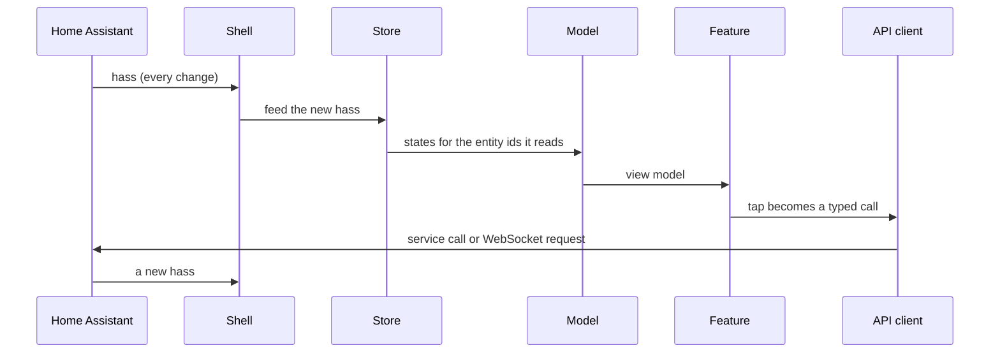

# Architecture

One page on where code goes and why. The words it uses (pane, sheet, tile, store, seam, adapter, house rule, display name) are defined in [CONTEXT.md](../CONTEXT.md). The reasoning behind each choice is in the [decision records](adr/README.md) and, for the plan as a whole, in the [programme spec](specs/production-grade-refactor.md) and [spec 09](specs/09-architecture-foundations.md).

Part of this is built and part is planned. The layer rules, the generated graph and the footprint number exist today. The store, the API client, the catalogs and the formatters are phase 2 work, and the providers, UI kit, features and shell are phase 3. Where a section describes something not yet built, it says so and names the spec.

## 1. Layers and the dependency rule

The layers are folders under `src/`. Dependencies point inward, toward the core. This is Robert C. Martin's Dependency Rule, the same shape as Cockburn's hexagonal architecture and Bernhardt's functional core, imperative shell (see the [reading list](#6-reading-list)). The reason is stated in [ADR 0011](adr/0011-layered-architecture-dependency-rule.md): features draw, models compute, only the core talks to Home Assistant.

| Layer                         | Folder                                                                                                                                                           | May import                                      | Must not import                                                                                   |
| ----------------------------- | ---------------------------------------------------------------------------------------------------------------------------------------------------------------- | ----------------------------------------------- | ------------------------------------------------------------------------------------------------- |
| Core (functional core)        | `src/core/`                                                                                                                                                      | `src/core/`, npm packages                       | anything else in `src/`; the DOM (`document`, `window`, `localStorage`, `navigator`)              |
| Providers                     | `src/providers/` (phase 3)                                                                                                                                       | `src/core/`                                     | features, UI kit, shell, legacy                                                                   |
| UI kit                        | `src/ui/` (phase 3)                                                                                                                                              | `src/core/` (tokens, types), `lit`              | features, providers, shell, legacy                                                                |
| Features (one folder each)    | `src/features/<name>/` (phase 3)                                                                                                                                 | `src/core/`, `src/ui/`, `src/providers/`, `lit` | another feature's folder, the shell, legacy                                                       |
| Shell (imperative shell)      | `src/shell/` (phase 3), `src/main.js`                                                                                                                            | everything                                      | nothing forbidden; it is the composition root                                                     |
| Legacy (the strangler's host) | `src/home-panel.js`, `src/auto.js`, `src/i18n/fr.js`, `src/legacy/`, `src/charts/`, `src/styles.js`, `src/css/`, `src/fonts.js`, `src/config.js`, `src/stack.js` | `src/core/`, legacy                             | features, UI kit, shell, providers. Nothing imports legacy except `src/main.js` and legacy itself |

The rules live in one place, [`.dependency-cruiser.cjs`](../.dependency-cruiser.cjs), one rule per row with a comment saying why. Beyond the table it forbids import cycles, modules nothing imports and imports that resolve to nothing. `npm run lint` runs it after ESLint, so a forbidden import fails the build and CI's lint job needs no extra step. An ESLint block also bans `document`, `window`, `localStorage`, `navigator` and similar globals in `src/core/`: a core module that needs the time zone, the locale or a `Storage` takes it as a parameter, which is what lets the core run in Node with no browser.

The folders for providers, UI kit, features and shell do not exist yet. Their rules name them so they apply from each folder's first file.

The module graph is drawn from the code, not from a slide: see [the dependency graph](architecture/dependency-graph.md). `npm run arch:graph` regenerates it, and a unit test fails when the committed file is stale, so do not edit it by hand.

One detail about the legacy row. The legacy set, written once in [`scripts/legacy-set.cjs`](../scripts/legacy-set.cjs), excludes `src/main.js`. That file is the shell's entry, the one module allowed to import legacy code, so it is not itself legacy. `npm run lint` ends by printing the legacy footprint, the number of modules the set still holds (see [the strangler fig](#4-the-strangler-fig)).

## 2. One-way flow

Data goes one way, and a change of mind goes round the whole loop.

1. Home Assistant hands the panel a `hass` object and sets it again every time something changes.
2. The shell receives `hass` and feeds the store.
3. The store holds the current `hass`, the resolved config, the user's locale and the formatters. It tells a subscriber only when one of the entity ids that subscriber reads has changed.
4. Models compute view models from what the store holds. A model is a pure function: `model(states, registries, config, now) → view model`.
5. Features render the view models. A tile is one of the compact blocks they draw.
6. A tap becomes a call through the API client, the one module that talks to Home Assistant's WebSocket.
7. Home Assistant acts, and answers by handing the shell a new `hass`. The loop starts again at step 1.



The panel never writes to `hass`. `hass` is Home Assistant's, and the panel treats it as a value to read. Three reasons, each from the specs:

- The store skips work by comparing state objects by reference between two `hass` objects, which is how Home Assistant's own cards do it (see _Frontend data_ in the [reading list](#6-reading-list)). A state object changed in place would defeat that check.
- Models take values and return values, with no DOM and no `hass` methods (the programme spec, phase 3). That is what makes them testable by calling them.
- Tests cross the panel at two seams: they hand it a `hass`, as Home Assistant does, or they call a pure function ([ADR 0005](adr/0005-two-seams-for-tests.md)). A panel that wrote to `hass` would have a third, hidden channel.

The shape is the Elm and Flux one of unidirectional data flow. Planned, not built yet: the store is [spec 10](specs/10-entity-store.md), the API client is [spec 12](specs/12-api-client.md), and the shell is phase 3. Today the legacy class still receives `hass` itself.

## 3. Where does this go?

| You are writing                   | It goes in                                                                       |
| --------------------------------- | -------------------------------------------------------------------------------- |
| A rule about a thermostat's state | A model (a pure function in the feature's folder)                                |
| A Hilo-specific entity name       | A provider (`src/providers/`)                                                    |
| A WebSocket message               | The core API client (`src/core/`; [spec 12](specs/12-api-client.md))             |
| A colour                          | UI kit tokens (`src/ui/`)                                                        |
| A string                          | The catalog, read through `t()` ([spec 11](specs/11-catalogs-and-formatters.md)) |
| A DOM event                       | The feature's element                                                            |

Two reminders from the same specs. A provider is a pure function that turns an integration's entities into the generic inputs the models expect, so a model never matches on an integration's entity naming (the anti-corruption layer of Evans). And a name a person gave in Home Assistant is data, not a code string: it goes through the display-name resolver, not the catalog ([spec 11](specs/11-catalogs-and-formatters.md)).

If two features need the same code, it cannot be shared sideways. It moves down into the UI kit, a provider or the core ([ADR 0011](adr/0011-layered-architecture-dependency-rule.md)).

## 4. The strangler fig

The panel is being rewritten in place, one feature per release, while it keeps running in the house ([ADR 0003](adr/0003-rewrite-in-place-strangler-fig.md)). The legacy code, the legacy set, is the host. It is the table's legacy row plus the files `scripts/legacy-set.cjs` adds to it (all of `src/i18n/` and the two declaration files) and minus `src/main.js`, the shell's entry. New layers grow around it and take over a feature at a time, until the legacy class is deleted. Fowler's _Strangler Fig Application_ names the shape, and _Parallel Change_ (expand, migrate, contract) names how a wide change such as removing the module globals stays mergeable.

How the set shrinks:

- A structural move changes no behaviour and no pixel. The screenshot baselines are the characterization tests that prove it ([ADR 0004](adr/0004-screenshot-baselines-are-the-contract.md)).
- Until a feature has moved, fixes and new work for it go into the legacy class and the move rebases on top. After it has moved, work goes into its folder.
- One feature moves per pull request. Each move extracts the model with unit tests against recorded fixtures, writes the Lit elements, subscribes only to the entity ids the model reads, and deletes the matching methods from the legacy class.
- The regular expression in `scripts/legacy-set.cjs` shrinks as modules move into a layer.

The move order of phase 3 is fixed and announced in the changelog of the release that starts it:

1. Weather
2. Media
3. Security
4. Air
5. Energy
6. Climate
7. Car
8. Lights
9. Home
10. Automations
11. Idle clock

The live-activity pill and the Status checks move with the shell's header and are extracted as their own feature after Energy and Car, which they read. The shell comes first: on its first release the legacy class mounts into a slot inside it and still draws every pane. The order starts with the features that have the least shared state (Weather, Media, Security, Air) and ends with the ones that read everything (Home, Automations, Idle clock), so the legacy class shrinks from its edges inward.

The footprint number is how many modules the legacy set still contains. `npm run lint` prints it as `legacy footprint: N modules`. It was 21 when this page was written. It counts files, declaration files included, so a move can lower it by more than one. A unit test also checks the other half of the rule: no module outside the legacy set imports a legacy module. The number is the progress figure of phase 3: it falls as modules move into a layer.

## 5. Coding conventions

**Module header.** Every module under `src/core/`, `src/providers/`, `src/ui/`, `src/features/` and `src/shell/` opens with a header comment of three to six lines: what the module is, the pattern it applies with its source in one phrase, and what it must not do. The legacy files are exempt. An illustration for a planned module:

```ts
// The entity store: holds the current hass, the config, the locale and the formatters.
// Pattern: the functional core, a deep module with a small interface (Bernhardt, Boundaries;
// Ousterhout, A Philosophy of Software Design).
// Must not: touch the DOM, call a hass method, or be imported as a singleton.
```

A pattern named in code uses the glossary's term, and the glossary uses the literature's name where there is one: seam, adapter, humble object, strangler fig.

**Parse, don't validate, at the edges.** Data from outside the panel (the config, a WebSocket reply, a `localStorage` read) is parsed into a typed value at the edge, once, and the rest of the code trusts the type. Problems are values, not exceptions, and the panel is a tolerant reader. The config schema is both the parser and the type ([spec 13](specs/13-config-schema.md)); replies are parsed in the API client, which rejects a stale reply ([spec 12](specs/12-api-client.md)). Source: King, _Parse, don't validate_.

**Pure models, with `now` passed in.** A model is a synchronous function from values to a view model, with no DOM and no `hass` methods. It does not read the clock: the caller passes `now`. Like the core's rule about the time zone, locale and storage, it accepts its dependencies and does not create them. This is why a model is tested by calling it with a recorded fixture.

**No `innerHTML` outside legacy.** The legacy class sets `innerHTML` in dozens of places (52 when this page was written) and escapes values by hand. New code uses Lit templates, with lists keyed by entity id, so no hand escaper is needed and focus, open sheets and drags survive a `hass` update.

**Strings through `t()`.** A string the user reads is a catalog key, looked up with `t(key, values)`. English is the source of keys and French must have every key. A missing key is a compile error and a missing French translation is a test failure ([spec 11](specs/11-catalogs-and-formatters.md); the catalogs and `t` are on the store, the charts-failed toast is the first string through them).

**Formats through the formatters.** Dates, times and numbers go through the formatter set, built on `Intl` from the Home Assistant profile, never through a hard-coded `en-CA`. The formatters are the one place that knows the three house rules: English `pm` without periods, French `16 h` for a time on the hour, and a narrow no-break space as the French thousands separator. Planned in [spec 11](specs/11-catalogs-and-formatters.md).

**Names through the resolver.** A name a person gave in Home Assistant (a room, a light, a scene, a camera, a player) is shown through `store.names.name(key)`, with an entity id, an area id or a device id, or with the name itself when a rule of the class already picked it (the room a thermostat names): the config's `names:` block, then the built-in room dictionary, then the name as Home Assistant gives it, in the language of the profile. Names are data, never message keys, and a resolved name is a value passed to `t()`. A read of `friendly_name` that feeds a rule (matching a platform, stripping `Thermostat ` to derive a key) is not a display read ([spec 11](specs/11-catalogs-and-formatters.md), [ADR 0013](adr/0013-locale-catalogs-and-names.md)).

**An ADR per decision.** A decision a future reader could reasonably argue with, or that constrains later code, gets a record in [docs/adr/](adr/README.md), in the same pull request as the code. An accepted record is never edited, except its Status line; a reversal is a new record that supersedes it.

## 6. Reading list

Each entry says what it gave the panel. Books are named by title and author.

**Structure**

- John Ousterhout, _A Philosophy of Software Design_. Deep modules: why the store and the API client have small interfaces over a lot of work.
- Gary Bernhardt, [_Boundaries_](https://www.destroyallsoftware.com/talks/boundaries). Functional core, imperative shell: the core/shell split, and why models take values.
- Alistair Cockburn, [_Hexagonal Architecture_](https://alistair.cockburn.us/hexagonal-architecture/). Ports and adapters: the API client is the port, `hass` is the adapter.
- Robert C. Martin, _Clean Architecture_. The Dependency Rule behind the layer table, and the Humble Object for the element.
- Gerard Meszaros, _xUnit Test Patterns_ ([Humble Object](http://xunitpatterns.com/Humble%20Object.html)). The element is the humble object and the store is the testable core.
- Eric Evans, _Domain-Driven Design_. Ubiquitous language, which is why [CONTEXT.md](../CONTEXT.md) exists, and the anti-corruption layer, which is what the providers are.

**Migration and tests**

- Martin Fowler, [_Strangler Fig Application_](https://martinfowler.com/bliki/StranglerFigApplication.html). The migration shape of [ADR 0003](adr/0003-rewrite-in-place-strangler-fig.md).
- Martin Fowler, [_Parallel Change_](https://martinfowler.com/bliki/ParallelChange.html). Expand, migrate, contract: how the module globals leave the legacy class without blocking other work ([spec 10](specs/10-entity-store.md)).
- Michael Feathers, _Working Effectively with Legacy Code_. Seams and characterization tests: the two test seams of [ADR 0005](adr/0005-two-seams-for-tests.md) and the screenshot baselines of [ADR 0004](adr/0004-screenshot-baselines-are-the-contract.md).
- Kent C. Dodds, [_The Testing Trophy_](https://kentcdodds.com/blog/the-testing-trophy-and-testing-classifications). Why most tests run at the `hass` seam.

**Decisions and data**

- Michael Nygard, [_Documenting Architecture Decisions_](https://www.cognitect.com/blog/2011/11/15/documenting-architecture-decisions). The ADR template of [ADR 0001](adr/0001-record-architecture-decisions.md).
- Alexis King, [_Parse, don't validate_](https://lexi-lambda.github.io/blog/2019/11/05/parse-don-t-validate/). The config schema, and the edge rule in section 5.
- Home Assistant developer docs, [_Frontend data_](https://developers.home-assistant.io/docs/frontend/data/). Reference equality on state objects: the store's change detection.

**Components and language**

- Lit docs, [_Context_](https://lit.dev/docs/data/context/) and [_Signals_](https://lit.dev/docs/data/signals/). How the store reaches components in phase 3 (Lit is the framework chosen in [ADR 0002](adr/0002-typescript-and-lit.md)).
- [Unicode CLDR](https://cldr.unicode.org/), [ICU MessageFormat](https://unicode-org.github.io/icu/userguide/format_parse/messages/) and the [FormatJS docs](https://formatjs.github.io/). The source of the locale data, the placeholder and plural syntax of the catalogs, and the library behind the formatters ([spec 11](specs/11-catalogs-and-formatters.md)).
