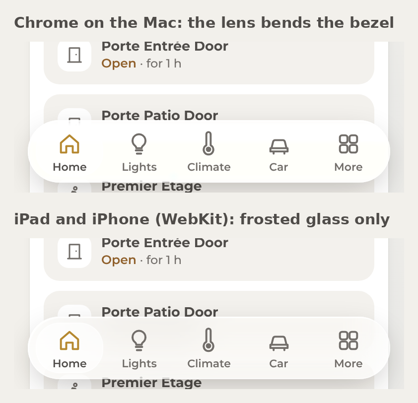

# Home panel in Liquid Glass (sketch)

> Moved from the Claude artifact [QVoqWJXbQ4euCBUskR38oZ](https://claude.ai/artifact/QVoqWJXbQ4euCBUskR38oZ), first published 2026-11-06.

Nov 6, 2026

## In short

Liquid Glass fits the navigation layer of the panel, not the cards. The sketch puts glass on the phone tab bar (a floating capsule), the header chips and buttons, the Status popup, the confirmation toast and the phone sheets. Cards, numbers and charts stay opaque, so nothing you read sits on a moving background.

The real lens (the refraction at the edges) only renders in Chrome on the Mac. The wall iPad and the iPhone run WebKit, which cannot put an SVG filter behind an element, so they get frosted glass: blur, saturation and a light rim. That is the same recipe Apple uses for the material layer, minus the bending of the edges.

Nothing is deployed. If you want it, it becomes v1.18.0 as its own PR, with a Glass on/off setting in the Status popup so the wall iPad can stay flat.

## Which browser engine Home Assistant uses

Home Assistant has no engine of its own. The frontend is a web app that runs in whatever browser opens it, and the panel inherits that browser.

| Where you open the panel                           | Engine                                                                      | Glass it can draw                                                            |
| -------------------------------------------------- | --------------------------------------------------------------------------- | ---------------------------------------------------------------------------- |
| Home Assistant app on the iPhone and the wall iPad | WKWebView, Safari's WebKit (Apple allows no other engine on iOS and iPadOS) | Frosted glass: blur, saturation, rim highlights                              |
| Safari on the iPad or the Mac                      | WebKit                                                                      | Frosted glass                                                                |
| Chrome on the Mac (the HA host:8123)               | Blink (Chromium)                                                            | Full effect: frosted glass plus the lens (edge refraction, chromatic fringe) |

The one feature that separates the two is `backdrop-filter: url(#filter)`, an SVG filter applied to what sits behind the element. Chromium runs it. WebKit drops the whole declaration, blur included, so the panel keeps a separate `-webkit-backdrop-filter` line without the `url()` part. The nordify README and source say the same: "Only Chromium runs url() filters inside backdrop-filter. Safari drops the whole declaration".

iOS 26's Liquid Glass is a system material. No web API asks for it, so a web page, including the Home Assistant app's web view, can only imitate it in CSS. What Apple draws natively in the app's own toolbar is not something the panel can share.

## What the glass is made of

All five of your sources build the material from the same four layers. The first two run everywhere, the last two only in Chromium.

| Layer      | What it does                                                                                                    | CSS                                                                                                   | Runs on             |
| ---------- | --------------------------------------------------------------------------------------------------------------- | ----------------------------------------------------------------------------------------------------- | ------------------- |
| Material   | A translucent fill, and the content behind it blurred and saturated                                             | `background: rgba(255,255,255,.34)` + `backdrop-filter: blur(14px) saturate(1.7) brightness(1.06)`    | WebKit and Chromium |
| Rim        | A 1 px light ring, a brighter top-left edge, a soft inner glow and a drop shadow                                | three inset `box-shadow` layers plus one outer shadow                                                 | WebKit and Chromium |
| Lens       | The edges bend what is behind them, like thick glass; a faint colour fringe (chromatic aberration) at the bezel | an SVG `feDisplacementMap` fed by a displacement map image, attached with `backdrop-filter: url(#id)` | Chromium only       |
| Reflection | A soft highlight that follows the edge                                                                          | nordify: a second SVG filter with `feGaussianBlur` on the bent image, masked to the rim               | Chromium only       |

What each source contributed:

- [kube.io](https://kube.io/blog/liquid-glass-css-svg/) explains the physics: the displacement map is computed from the glass profile (a bezel curve and a refractive index), red encodes the x shift and green the y shift, 128 means no shift. Three `feDisplacementMap` passes with slightly different scales, each isolated to one colour channel and recombined with `feBlend`, give the chromatic fringe. Chrome only, and it says so.

- [hiredigital](https://hiredigital.com/tools/liquid-glass-css-generator) is the plain recipe: the fill, the blur and saturate values, the inset highlights, and an SVG filter you paste in. Its numbers are the starting point for the sketch's material and rim.

- [nordify/css-liquid-glass](https://github.com/nordify/css-liquid-glass) is the most careful engineering. One SVG filter inside `backdrop-filter`, greyscale maps on purpose (Chrome mangles coloured filter inputs on Display P3 screens), the finished map baked to a PNG after 300 ms for speed, a light and dark tuning through one `--lg-dark` variable, and a clear fallback: outside Chromium it keeps `blur(2px) saturate(1.1)` plus the edge light. It also lists what breaks the effect: any `isolation`, `filter`, `opacity`, `mask`, `will-change` or `overflow: hidden` on the element or an ancestor makes a new backdrop root, and the glass then refracts only itself.

- [nikdelvin/liquid-glass](https://github.com/nikdelvin/liquid-glass) is an Astro component with the same filter primitives and props for depth, strength, blur and chromatic aberration. Its README claims full Firefox support and a Safari fallback to plain glassmorphism. I could not read its source (the repository blocks automated fetches), so I took nothing from it beyond the prop list.

- [aethercss.lovable.app](https://aethercss.lovable.app) is a generator app whose output is built in the browser, so nothing could be read from it here. Its presets are the same layers as above.

The sketch uses the hiredigital material and rim values, the kube.io three-pass lens with a map drawn per element (a blurred neutral centre so only the bezel bends), and nordify's fallback rule and backdrop-root caveats.

## Where the glass goes, and where it does not

Apple puts Liquid Glass on the layer that floats above content (tab bars, toolbars, sheets, popovers) and keeps content itself flat. The sketch follows that split.

| Element                                                          | Glass                                                                                 | Why                                                                                       |
| ---------------------------------------------------------------- | ------------------------------------------------------------------------------------- | ----------------------------------------------------------------------------------------- |
| Phone tab bar                                                    | Yes: a floating capsule 14 px in from the edges, the selected tab in a lighter bubble | It is the one element that sits over scrolling content, so the blur has something to show |
| iPad rail                                                        | Yes: the same capsule, vertical                                                       | Same reason, and it is the only chrome on the wall iPad                                   |
| Header chips and round buttons (weather, attention, theme, menu) | Yes                                                                                   | They float over the greeting area                                                         |
| Status popup and the confirmation toast                          | Yes                                                                                   | Transient layers above content                                                            |
| Phone sheets (light, weather, energy)                            | The sheet's own frame only, the cards inside stay opaque                              | The sheet is a layer; its controls are content                                            |
| Tiles, cards, charts, Security rows, timeline                    | No, they stay opaque cream or dark                                                    | Numbers and labels need a stable background; glass under a chart halves its contrast      |
| Error toasts and the attention dot                               | No, solid colour                                                                      | A warning must not fade into whatever is behind it                                        |

Two background options, since glass needs something behind it to be glass:

- A: keep the flat cream (and the flat dark). The glass shows mostly as a frosted edge and the blurred cards passing under the bar. Quiet, closest to what you have.

- B: a soft wallpaper, three faint radial washes (warm sand top-left, sage top-right, slate at the bottom) over the cream, fixed while the content scrolls. The glass has colour to bend and blur, which is where Apple's material looks like glass rather than fog. The dark theme uses the same washes at a third of the strength.

The renders below show both.

## The sketches

Three images, rendered from the real v1.17.0 bundle in the test harness with the glass CSS injected, in Chromium at 2x. Phone is 393 by 852 (iPhone 16), iPad is 1180 by 820 (iPad landscape).

Phone home, left to right: today, glass on the flat cream (A), glass on the soft wallpaper (B), and a light sheet open on B. The tab bar becomes a floating capsule with the selected tab in a lighter bubble, the menu and theme buttons and the attention chip turn to glass, the cards stay solid.

_(Screenshot of the live panel left out of the public repo: Phone home: now, glass on flat cream, glass on soft wallpaper, and a light sheet.)_

iPad home: today, then B in light, then B in dark. The rail is the glass capsule, the header chips go glass, and the wallpaper washes are what you see bending at the rail's edge.

_(Screenshot of the live panel left out of the public repo: iPad home: now, glass on soft wallpaper in light, and in dark.)_

Tab bar detail: what Chrome on the Mac draws (the bezel bends the row edges under it, with a faint colour fringe) against what the iPad and iPhone draw (the same frosted material, straight edges). The difference is real but small, which is the point: the frosted version carries the look on its own.

## How it would be built

About 60 lines of CSS and 40 lines of JavaScript on top of v1.17.0, no new library, no change to the HA config beyond the usual `?v=` bump. The whole thing hangs on one class, `glass`, that the panel adds to the navigation elements when the setting is on.

The material and rim, which every engine draws:

    .app{--g-fill:rgba(255,255,255,.34);--g-ring:rgba(255,255,255,.4);--g-hi:rgba(255,255,255,.7);
         --g-glow:rgba(255,255,255,.22);--g-sel:rgba(255,255,255,.62);--g-sheet:rgba(246,244,239,.74);
         --g-shadow:0 10px 32px -8px rgba(30,24,18,.3)}
    .app[data-theme="dark"]{--g-fill:rgba(48,46,43,.5);--g-ring:rgba(255,255,255,.13);--g-hi:rgba(255,255,255,.22);
         --g-glow:rgba(255,255,255,.05);--g-sel:rgba(255,255,255,.13);--g-sheet:rgba(34,32,30,.76);
         --g-shadow:0 12px 36px -8px rgba(0,0,0,.6)}
    .glass{background:var(--g-fill);border:0;
      -webkit-backdrop-filter:blur(14px) saturate(1.7) brightness(1.06);
      backdrop-filter:blur(14px) saturate(1.7) brightness(1.06);
      box-shadow:inset 0 0 0 1px var(--g-ring),inset 1.5px 1.5px 0 var(--g-hi),inset 0 0 12px var(--g-glow),var(--g-shadow)}
    .app.cp .rail.glass{left:14px;right:14px;bottom:calc(10px + env(safe-area-inset-bottom));border-radius:34px;padding:6px 8px}
    .app.cp .rail.glass .rtab[aria-selected="true"]{background:var(--g-sel);border-radius:24px}
    .app.cp .sheet>.panel.glass{background:var(--g-sheet);backdrop-filter:blur(24px) saturate(1.6);border-radius:30px 30px 0 0}
    @media (prefers-reduced-transparency:reduce){.glass{backdrop-filter:none;-webkit-backdrop-filter:none;background:var(--card)}}

The lens, Chromium only, added by JavaScript so WebKit never sees it:

1.  For each glass element, draw a displacement map the size of the element: a neutral grey image, a red-to-black gradient across (x shift) and a green-to-black gradient down (y shift) screened together, then a blurred neutral rounded rectangle in the middle so only a bezel of 16 to 22 px bends.

2.  Build one SVG filter per element in the panel's shadow root: `feImage` with that map, then three `feDisplacementMap` passes at scale, scale minus 3 and scale minus 6, each kept to one colour channel with `feColorMatrix` and recombined with `feBlend mode="screen"`. That is the chromatic fringe.

3.  Set `element.style.backdropFilter = "blur(1px) url(#id) blur(3px) saturate(1.7) brightness(1.06)"` only when `CSS.supports` and a Chromium user agent agree. The `-webkit-backdrop-filter` line from the CSS stays as it is, so WebKit keeps the frosted version.

4.  Redraw the map on resize and when the text size setting changes, since the filter is sized to the element.

The wallpaper, option B, is one rule on `.app`: three `radial-gradient` washes over the cream, `background-attachment: fixed`, and the same washes at a third of the opacity in dark.

Two rules from nordify that decide whether it works at all: no `overflow: hidden`, `isolation`, `filter`, `opacity`, `mask` or `will-change` on a glass element or any ancestor up to the panel, or the blur sees only the element itself; and the glass elements must not be inside a container that scrolls separately from the content they are supposed to blur. The phone bar and the iPad rail are already fixed-position children of the app root, so they qualify. The sheets are too.

## Risks and the settings that cover them

| Risk                                            | What happens                                                                                                   | Cover                                                                                                                                                                                    |
| ----------------------------------------------- | -------------------------------------------------------------------------------------------------------------- | ---------------------------------------------------------------------------------------------------------------------------------------------------------------------------------------- |
| Readability on glass                            | Labels on the tab bar sit on whatever scrolls under it; the HIG review's contrast pass was done on solid cream | Keep tab labels at full weight and dark grey, keep `--g-fill` at .34 or more; the audit script runs again on the glass build before any deploy                                           |
| GPU and battery on the wall iPad                | `backdrop-filter` re-renders the blurred region on every scroll frame; the wall iPad runs the panel 24 h a day | The iPad rail is the only glass element on the home pane, and it blurs a 96 px strip; a Glass off setting in the Status popup, remembered in localStorage like the theme and text size   |
| Reduce Transparency (iOS setting)               | Apple turns Liquid Glass opaque system-wide                                                                    | `prefers-reduced-transparency: reduce` turns the glass elements back into cream cards; WebKit support for that media query is recent, so the manual setting above is the reliable switch |
| Increase Contrast                               | The v1.17.0 `prefers-contrast: more` block darkens the greys                                                   | The same block also sets `--g-fill` to .85, so glass becomes near-solid                                                                                                                  |
| Motion                                          | Apple's glass moves with scrolling and the lens shimmers                                                       | The sketch has no animation; nothing to turn off under `prefers-reduced-motion`                                                                                                          |
| Chrome on the Mac looks different from the iPad | The lens only draws in Chromium                                                                                | Expected, and the difference is subtle (see the detail render); nothing depends on it                                                                                                    |
| Backdrop-root pitfalls                          | One `overflow: hidden` on an ancestor, and the glass blurs nothing                                             | The glass elements are direct children of the app root; the build script's checks would assert that `getComputedStyle` on the ancestors shows none of the six properties                 |
| HA app updates                                  | A future Home Assistant frontend could wrap custom panels in a container with `overflow: hidden`               | Same assertion at runtime: if the blur has no backdrop, the panel removes `glass` and falls back to cards                                                                                |

## Decision

My recommendation: build it as v1.18.0 with option B (the soft wallpaper) on the iPhone and option A (flat cream) as the default on the wall iPad, both behind a Glass setting in the Status popup that defaults to on for the phone and off for the iPad. The phone is where the bar floats over scrolling content and where iOS 26 already looks like this; the wall iPad shows a static home pane all day, so it gains little and pays the GPU cost.

What I need from you:

- [ ] Go or no go on v1.18.0

- [ ] Phone background: A (flat cream) or B (soft wallpaper)

- [ ] Wall iPad: glass on, off, or the setting only

If go, it is one PR on top of PR \#5, with the HIG audit script run again on the glass build before deploy, and nothing touches the HA config except the `?v=` bump.
